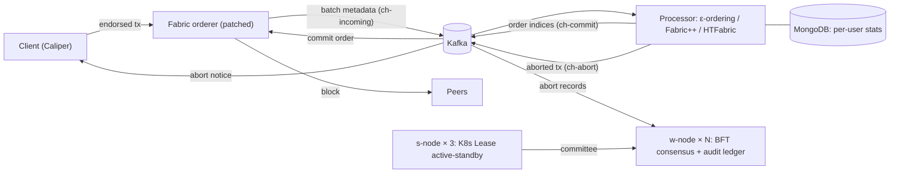
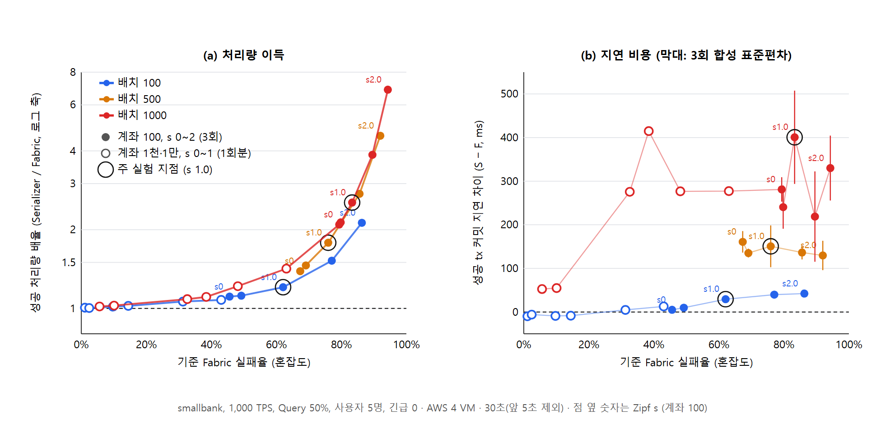

# Serializer Extended

**Hyperledger Fabric의 트랜잭션 충돌을 블록에 넣기 전에 푸는 외부 정렬 서비스: 연구 이후 확장판**

Fabric 오더러는 트랜잭션을 도착한 순서대로 블록에 넣습니다. 그래서 같은 블록 안에서 앞선 트랜잭션이 쓴 키를 뒤의 트랜잭션이 읽으면, 뒤의 것은 피어에서 MVCC 충돌로 무효가 됩니다. Serializer는 배치를 오더러 밖(Kafka 프로세서)으로 보내 읽기→쓰기 의존 관계로 순서를 다시 정합니다. 충돌 고리에 걸린 트랜잭션만 버리고, 버린 기록은 별도의 BFT 합의망(Watchdog)이 원장에 남깁니다.

> **원 연구:** 연구실 재학 중 진행한 연구로, 논문 *Serializer: Transaction-Aware Byzantine Fault Tolerant Ordering Service for Fabric Blockchain*(IEEE Access 투고, 지도교수 박기석 교수 공동 저자)으로 정리했습니다. 원 코드: [jhikyuinn/Serializer](https://github.com/jhikyuinn/Serializer)
>
> **이 저장소:** 원 연구 이후 기능과 실험을 [확장](#원-연구에서-확장한-것)한 버전입니다. README의 수치는 모두 이 저장소의 코드로 직접 측정한 값이고, 넓힌 측정 범위에서 새로 확인한 내용은 [아래](#확장-실험에서-추가로-확인한-것)에 정리했습니다.

**Go · Kafka(goka, sarama) · MongoDB · libp2p · BLS · QUIC · Kubernetes(Lease, PDB) · Hyperledger Fabric · Caliper · AWS EC2 · Docker**

## 핵심 결과

| | 결과 | 조건 |
|---|---|---|
| 성공 처리량 | Fabric 대비 **×1.21 / ×1.78 / ×2.54** (배치 100 / 500 / 1000) | AWS VM 4대, 1,000 TPS, smallbank, Zipf s 1.0, 3회 |
| 혼잡할수록 이득 | 최대 **×6.86** (Fabric 실패율 94%), 실패율 15% 이하에서는 ×1.00~1.03 | 같은 환경, s 0~2 |
| 지연 비용 | 배치 100에서 커밋 지연 **+29 ms**, 배치 1000에서 +401 ms | 같은 환경 |
| 비교 시스템 | 성공 126.0/s: Fabric 94.9(**+33%**), HTFabric 115.6, Fabric++ 111.1 | 로컬, 250 TPS, 사용자 5명, 3회 |
| 검증 노드 장애 복구(MTTR) | **11.8 s → 5.4 s** (중앙값), 잘못된 전환 0회 | s-node pod 3개, w-node 10개, 유형별 10회 |
| 커밋 경로 지연 | 원인 미상의 40 ms 고정 지연을 찾아 커밋 지연 **626 → 546 ms** | 7개 구간 계측 |

## 원 연구에서 확장한 것

| 영역 | 확장한 내용 |
|---|---|
| 검증 노드 가용성 | s-node를 Kubernetes Lease 기반 active-standby(pod 3개)로 다중화. 장애 복구 5.4 s |
| 합의 정합성 | 정족수를 채운 블록만 기록, 원장에 Kafka 오프셋 구간을 남겨 이어서 처리, 실패하면 새 커미티로 재시도 |
| 정렬 경로 | 오더러는 tx 메타데이터만 보내고(523 → 32 KB) 프로세서는 순서 인덱스만 돌려준다(약 290 B). 정렬 왕복 약 16 ms |
| abort 통보 | 클라이언트가 abort 토픽을 구독해 버려진 tx를 약 0.5 s 안에 안다(커밋 대기 10 s 대신) |
| 비교 시스템 | Fabric++, HTFabric(WARD)을 같은 프로세서 자리에 구현해 같은 부하로 비교 |
| 벤치마크·계측 | Caliper 다중 사용자·긴급 tx·Zipf 워크로드, 커밋 경로 7개 구간 계측, 오더러 계측 |
| 실험 범위 | AWS VM 4대에서 1,000 TPS, 배치 100~1000, Zipf s 0~2, 장애 유형별 MTTR 반복 측정 |

## 구조



| 구성 요소 | 위치 | 역할 |
|---|---|---|
| 오더러 수정분 | [`fabric-patch/`](fabric-patch/README.md) | 배치를 Kafka로 보내고 프로세서가 정한 순서로 블록 생성. 바꾼 파일만 담았다 |
| 프로세서 | [`kafka/`](kafka/README.md) | 의존 그래프로 순서 결정, 고리에서만 abort, 긴급 tx 우선, 사용자별 실패 통계. 비교용 Fabric++·HTFabric 구현 포함 |
| s-node | [`watchdog/s-node/`](watchdog/s-node/README.md) | w-node 커미티 구성. Kubernetes Lease로 active-standby 다중화 |
| w-node | [`watchdog/w-node/`](watchdog/w-node/README.md) | abort 기록의 BFT 합의(BLS 서명)와 감사 원장 |
| 벤치마크 | [`bench/`](bench/README.md) | Caliper 다중 사용자 워크로드, 실행·집계·그림 스크립트 |
| 배포 | [`deploy/cloud/`](deploy/cloud/README.md) | AWS VM 4대 구성 스크립트 |
| 실험 | [`experiments/`](experiments/cloud-figs/README.md) | 클라우드 그림과 데이터, MTTR 측정 스크립트 |

## 결과

### 배치 크기: Fabric은 무너지고 Serializer는 버틴다


- Fabric은 배치가 커질수록 같은 블록 안의 충돌이 늘어 성공 처리량이 379 → 168/s로 떨어진다. Serializer는 426~457/s를 지킨다.
- 대가는 지연이다. 배치 100에서는 사실상 같지만(+29 ms, 모든 tx 기준 +6 ms), 배치 1000에서는 +401 ms다.

### 혼잡도: 이득은 실제 충돌 정도에 따라 정해진다



- 가로축은 Zipf s가 아니라 **기준 Fabric의 실패율**이다. 계좌 수·s·배치가 달라도 한 축에 놓을 수 있다.
- 모든 지점에서 배율이 1 이상이다(역전 없음). 충돌이 적으면 같고, 실패율 60%를 넘으면 급격히 커진다.

### 읽기 전용 트랜잭션과 블록 낭비

| 배치 (s 1.0) | Query 성공률 Fabric → Serializer | 블록 안 무효 비율 Fabric → Serializer |
|---|---|---|
| 100 | 39% → 64% | 62% → 34% |
| 500 | 24% → 77% | 76% → 23% |
| 1000 | 16% → 82% | 83% → 19% |

- 읽기 전용 tx를 블록 맨 앞에 두므로 같은 블록 안에서는 무효가 0이다.
- 충돌할 tx를 블록에 넣지 않으므로, 피어가 무효 tx를 검증하는 데 쓰는 일이 2~13배 준다.
- 다섯 사용자 모두 성공이 늘고, 네트워크가 먼 사용자일수록 더 는다(가장 먼/가까운 사용자의 성공 비 0.50 → 0.64).

### 비교 시스템 (로컬, smallbank)

| 시스템 | 성공/s (긴급 0 / 1) | Query 성공률 | 긴급 tx 성공률 | 사용자 간 sd | 커밋 지연 |
|---|---|---|---|---|---|
| Fabric 2.5 | 94.9 | 38.9% | - | 4.00 | 509 ms |
| Fabric++ | 111.1 / 111.3 | 56.4% | 32.1% | **1.48** | 574 ms |
| HTFabric (WARD) | 115.6 / 118.6 | 56.9% | 32.5% | 4.54 | 570~602 ms |
| **Serializer** | **126.0 / 123.5** | **67.4%** | **43.9%** | 3.62 | 563 ms |

Fabric++와 HTFabric은 같은 프로세서 자리에 논문대로 구현해 같은 부하로 비교했습니다. 전체 표와 보조 부하(custom) 결과는 [docs/summary.md](docs/summary.md#5-최종-수치-재실험-abort-전송-수정-후-40)에 있습니다.

### 검증 노드 장애 복구 (MTTR)

MTTR은 장애가 난 때부터 **모든 w-node가 새 커미티를 받아 합의를 다시 할 수 있을 때까지**로 정의했습니다.

| 장애 | 이전 (Lease 6 s) | 현재 (Lease 2 s + 수정) | Lease 1 s (기각) |
|---|---|---|---|
| 강제 종료 (SIGKILL) | 10.8 s | **5.4 s** (4.6~5.9) | 2.9~4.3 s |
| 멈춤 (SIGSTOP) | 11.8 s | **5.4 s** (5.0~6.3) | 3.5~4.3 s |
| 정상 종료 | 5.1 s, 1회 복구 실패 | 5.6 s, 10/10 | 4.0~5.1 s |

## 지는 곳과 비용

결과가 불리한 경우도 그대로 적었습니다.

- **지연:** 배치 500·1000에서는 커밋 지연이 +130~400 ms 늘어난다. 이득이 지연 비용보다 큰지는 배치 크기에 따라 다르다.
- **보조 부하(custom)에서는 논문의 ε 값(0.1 / 0.75)으로 HTFabric에 진다**(87.3 대 107.9/s). ε을 1/1로 두면 111.5/s로 비슷해진다. ε은 부하에 맞춰 골라야 한다.
- **공정성(사용자 간 편차)은 Fabric++가 가장 좋다.**
- **혼잡할 때 1,000 TPS를 다 받지 못한다**(867~986 TPS). 블록 하나의 처리는 빠르지만 블록 간격이 2~16% 길다. 원인을 아직 다 나누지 못했다.
- **측정 범위:** 비교 시스템과의 비교는 단일 PC(상한 약 400 TPS)에서 했다. HTFabric은 정렬(WARD)만 비교했고 피어 쪽 재실행(TSP)은 뺐다.

## 문제 해결 사례

자세한 경위는 [docs/summary.md](docs/summary.md#2-문제--원인--해결--결과)와 [실험 노트](docs/lab-notebook.md)(§ 번호)에 있습니다.

**1. 설명되지 않는 40 ms 고정 지연 (§37~§38)**
- **문제:** Serializer의 커밋 지연이 HTFabric보다 40~80 ms 길었다. 정렬 계산은 배치당 1 ms 미만이라 알고리즘 탓으로는 설명되지 않았다.
- **원인 찾기:** 프로세서 → Kafka → 오더러 → raft → 피어를 7개 구간으로 나눠 블록 번호로 짝지었다. 차이는 "commit 전송 → 오더러 수신" 한 구간(9 대 48 ms)에만 있었고, 버린 tx 수와 무관한 고정값이었다. commit 직후 **같은 producer 연결**로 나가는 큰 abort 기록이 commit을 막는다고 가설을 세웠고, 세 방식으로 대조 실험을 해 확정했다.
- **결과:** abort 전송을 별도 연결로 분리해 해당 구간이 48 → 7 ms, 커밋 지연이 626 → 546 ms가 됐다. 이후 모든 비교 실험(83회)을 다시 돌렸다.

**2. 틀린 가설을 구현 전에 버린 경우 (§44~§46)**
- **문제:** 부하가 오를수록 외부 정렬의 추가 지연이 커졌다. 배치를 프로세서로 보내는 구간이 왕복의 약 70%였다.
- **처음 가설:** 메시지(약 520 KB)가 커서 느리다.
- **실측:** 같은 메시지를 Docker 내부망으로 보내면 매번 약 3 ms였다. 원인은 크기가 아니라 측정 환경(Docker Desktop의 포트 전달 프록시, 일부 전송에 +45 ms)이었다. 이 비용은 Kafka를 거치는 시스템에만 붙어 비교를 왜곡하고 있었다.
- **결과:** Kafka 주소를 설정으로 바꿔 내부망으로 연결했다. 오더러는 tx 메타데이터만 보내도록 바꿨다. 메시지 523 → 32 KB, 정렬 왕복 약 70 → 16 ms.

**3. 장애 복구 시간 절반 이하로, 위험한 개선은 기각 (§48~§49)**
- 구간 계측으로 병목 6개를 찾았다. Lease 만료, 재접속 주기, **libp2p dial backoff**(실패 후 약 5초 동안 다시 다이얼하지 않음), 커미티 대기, 활성 직후 커미티 분할, 늦게 붙은 노드 고립.
- 고친 결과 MTTR이 11.8 → 5.4 s가 됐다.
- Lease 1 s로는 약 3 s까지 줄었지만, 부하가 걸린 PC에서 잘못된 활성 전환과 pod 재시작이 생겨 채택하지 않았다.

**4. 합의되지 않은 기록이 원장에 남던 문제 (§11~§14)**
- w-node가 정족수에 못 미쳐도 블록을 기록했고, s-node는 노드 하나로도 커미티를 만들었다.
- 원장 블록에 Kafka abort 토픽의 반영 구간(파티션별 오프셋)을 적어, 노드별 상태 없이 "합의된 것만 기록, 실패하면 새 커미티로 재시도"를 구현했다. 리더 장애와 복귀 시나리오에서 중복이나 미합의 블록이 없음을 확인했다.
- 원장의 사용자별 abort 집계가 늘 비어 있던 원인은 직렬화 타입 불일치였다. "MongoDB 연동 문제"라는 처음 가설을 데이터로 기각했다.

## 설계 결정

| 결정 | 검토한 대안 | 고른 것과 이유 |
|---|---|---|
| s-node 단일 장애점 제거 | ① 모든 pod 동작 + Kafka 조율 ② pod 간 libp2p 메시 ③ Lease active-standby | ③. ①은 구현·검증 뒤 버렸다(검증 노드의 가용성이 Kafka에 묶임). ②는 전환 순간 커미티가 중복될 수 있다 |
| Lease 시간 | 6 s / 2 s / 1 s | 2 s. 1 s는 부하에서 잘못된 전환이 생겼다 |
| 무상태 커미티 (MTTR 약 1 s) | 도입 / 보류 | 보류. 악의적인 w-node의 목록 조작을 막는 검증이 먼저 필요하다 |
| abort 전송 | 같은 연결 / 별도 연결 / 100 ms 지연 | 별도 연결. 지연 방식은 abort 통보까지 늦춘다 |
| 논문 알고리즘 개선 | 그대로 고치기 / 별도 이름 | 논문 의미를 바꾸는 개선(SCC 분해 등)은 별도 이름(`B`)으로만 비교한다 |
| 대표 실험 조건 | 결과가 가장 좋은 s / 미리 정한 s | s 1.0(YCSB 기본 0.99). 결과를 보고 고르면 유리한 지점만 골랐다는 지적을 피할 수 없다 |

## 확장 실험에서 추가로 확인한 것

측정 범위를 넓혀(Zipf s 0~2, 배치 100~1000, 클라우드 1,000 TPS, 장애 유형별 반복) 다시 측정했습니다.

| 항목 | 원 실험 | 확장 실험 결과 |
|---|---|---|
| 이득이 나타나는 혼잡도 | s > 1.15 구간에서 앞섬 | s 0~2 전체에서 앞섬. 균등 분포(s 0)에서도 +9~11% |
| 외부 정렬의 추가 지연 | 약 +50 ms | 부하에 따라 달라짐. 로컬에서 200 TPS 이하 +20~50 ms, 300 TPS 이상 +40~90 ms |
| 검증 노드 복구 시간 | 350 ms (시뮬레이션 설정값) | 실제 구조에서 "모든 w-node가 다시 합의할 수 있을 때까지"를 측정해 5.4 s (활성 pod 전환만은 0.5~2.2 s) |
| ε 설정 | 0.1 / 0.75 | smallbank·클라우드 실험은 이 값으로 진행. custom 부하에서는 ε 1/1이 더 높아, 부하에 맞춰 고르는 것이 좋다 |

비교 논문을 구현하면서 찾은 문제도 있습니다. HTFabric 의사코드의 in/out-degree가 정의와 반대로 되어 있었고, Fabric++의 고리 열거는 2,000건 배치에 80초가 걸려 Johnson 알고리즘으로 바꿨습니다(결과는 같음).

## 한계와 다음 단계

- **오더러 lock-step:** 배치 하나를 보내고 결과를 기다린다. 배치 ID로 여러 배치를 겹쳐 처리할 수 있다.
- **프로세서 장애 시 오더러가 멈춘다:** 타임아웃 후 도착순으로 대체해야 한다.
- **배치 사이의 낡은 읽기:** 프로세서가 상태를 갖지 않아 이전 블록 때문에 낡은 tx를 미리 거르지 못한다. 남은 실패 대부분이 여기서 나온다. 키별 마지막 쓰기 버전을 유지하는 상태 S를 도입하는 것이 다음 단계다.
- **토픽·consumer group 고정:** 오더러나 채널이 여럿이면 채널별로 나눠야 한다.
- **다중 경로 전송(MP2BTP):** w-node 간 합의 메시지를 두 경로로 나눠 보내는 전송을 실험했다. 외부 연구실 라이브러리를 수정해 쓴 것이라 **이 저장소에서는 빼고 비공개로 두었다.** 공개본의 w-node는 QUIC으로만 동작한다.

## 저장소 구조

```
├── fabric-patch/   Fabric 오더러 수정분(바꾼 파일만)과 적용 방법
├── kafka/          정렬 프로세서(Go), Kafka·MongoDB compose
├── watchdog/
│   ├── s-node/     커미티 구성, Kubernetes 매니페스트(k8s/)
│   └── w-node/     BFT 합의, 감사 원장, QUIC 전송 (MP2BTP 전송은 비공개)
├── bench/          Caliper 워크로드, 실행·집계·그림 스크립트
├── deploy/cloud/   AWS 4 VM 배포 스크립트
├── experiments/    클라우드 그림·데이터, MTTR 측정 스크립트
└── docs/
    ├── summary.md       문제 → 원인 → 해결 → 결과, 전체 수치 표
    └── lab-notebook.md  실험 노트(§1~§67), 모든 수치의 근거
```

## 실행 (로컬)

Windows + Docker Desktop(Kubernetes 켬)과 AWS의 Ubuntu에서 돌렸습니다. Go 빌드는 모두 Docker 안에서 합니다.

```bash
# 1) 수정된 Fabric 이미지 (자세히: fabric-patch/README.md)
git clone https://github.com/hyperledger/fabric.git fabric && git -C fabric checkout 08cd8a667
cp -r fabric-patch/files/. fabric/
#    → fabric-patch/README.md 의 docker build 명령으로 serializer/fabric-{orderer,peer,tools} 빌드

# 2) Kafka + 프로세서 + MongoDB
cd kafka && cp .env.example .env
docker compose -f docker-compose.yml -f docker-compose.processor.yml up -d && cd ..

# 3) s-node (Kubernetes) — 태그는 k8s/kustomization.yaml 의 newTag 와 같게
docker build -t watchdog/s-node:mttr-1017g watchdog/s-node
kubectl apply -k watchdog/s-node/k8s

# 4) w-node 4개 (커미티 최소 4명)
docker build -t watchdog/w-node:latest watchdog/w-node
watchdog/w-node/run_local.sh 4 mychannel -padding 1000000

# 5) 벤치마크: 같은 소스 Fabric(A1) 대 Serializer(BE)
cd bench/zipfbench
RUN_ID=demo SYSTEMS="A1 BE" URGENT_LIST=0 REPS=1 ./userbench.sh
node aggregate-users.js results/demo
```

클라우드(1,000 TPS) 실행은 [deploy/cloud/README.md](deploy/cloud/README.md)에 있습니다.
