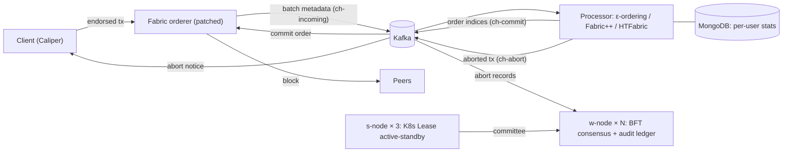

# Serializer Extended

**Hyperledger Fabric의 트랜잭션 충돌을 블록에 넣기 전에 푸는 외부 정렬 서비스: 연구 이후 확장판**

Fabric 오더러는 트랜잭션을 도착한 순서대로 블록에 넣습니다. 그래서 같은 블록 안에서 앞선 트랜잭션이 쓴 키를 뒤의 트랜잭션이 읽으면, 뒤의 것은 피어에서 MVCC 충돌로 무효가 됩니다. Serializer는 배치를 오더러 밖(Kafka 프로세서)으로 보내 읽기→쓰기 의존 관계로 순서를 다시 정합니다. 충돌 고리에 걸린 트랜잭션만 버리고, 버린 기록은 별도의 BFT 합의망(Watchdog)이 원장에 남깁니다.

> **원 연구:** 연구실 재학 중 진행한 연구로, 논문 *Serializer: Transaction-Aware Byzantine Fault Tolerant Ordering Service for Fabric Blockchain*(IEEE Access 투고, 지도교수 박기석 교수 공동 저자)으로 정리했습니다. 원 코드: [jhikyuinn/Serializer](https://github.com/jhikyuinn/Serializer)
>
> **이 저장소:** 원 연구 이후 기능과 실험을 [확장](#원-연구에서-확장한-것)한 버전입니다. 수치는 모두 이 저장소의 코드로 직접 측정한 값입니다.

**Go · Kafka(goka, sarama) · MongoDB · libp2p · BLS · QUIC · Kubernetes(Lease, PDB) · Hyperledger Fabric · Caliper · AWS EC2 · Docker**

## 핵심 결과

| | 결과 | 조건 |
|---|---|---|
| 성공 처리량 | Fabric 대비 **×1.31 / ×2.10 / ×2.98** (배치 100 / 500 / 1000) | AWS VM 4대, 1,000 TPS, smallbank, Zipf s 1.0, 3회 |
| 혼잡할수록 이득 | 최대 **×7.93** (Fabric 실패율 94%) | 같은 환경, s 0~2 |
| 커밋 지연 | 모든 조건에서 Serializer가 짧음: 배치 100 **−18 ms**, 배치 1000 **−143 ms** | 같은 환경, s 1.0 |
| 고부하 | 4,000 TPS·배치 5000에서 성공 **643/s** (Fabric 14/s) | 같은 환경, 1회 |
| ε 조절 | 작은 배치에서 ε 1이 성공 **+51%**, 큰 배치에서는 작은 ε가 1 s 마감을 지킴 | custom 부하, 클라우드·시뮬레이션 |
| 비교 시스템 | 성공 503/s: Fabric 382(**+32%**), HTFabric 474, Fabric++ 452. 긴급 tx 성공 +10%p | AWS, 1,000 TPS, smallbank, 사용자 5명, 3회 |
| 성공 tx당 자원 | 피어 CPU **−23%**, 원장 **−43%**, 실패 통보 153 ms (Fabric 226) | 같은 환경, smallbank |
| 검증 노드 장애 복구(MTTR) | **11.8 s → 5.4 s** (중앙값), 잘못된 전환 0회 | s-node pod 3개, w-node 10개, 유형별 10회 |
| 합의 성공률 | pod 장애 15%에서 pod 1개 79.5% → **3개 99.1%** | 실측 MTTR로 보정한 시뮬레이션, w-node 10개 |

전체 결과와 비용·한계는 [docs/results.md](docs/results.md), 실험별 기록은 [experiments/](experiments/README.md)에 있습니다.

## 원 연구에서 확장한 것

| 영역 | 확장한 내용 |
|---|---|
| 검증 노드 가용성 | s-node를 Kubernetes Lease 기반 active-standby(pod 3개)로 다중화. 장애 복구 5.4 s |
| 합의 정합성 | 정족수를 채운 블록만 기록, 원장에 Kafka 오프셋 구간을 남겨 이어서 처리, 실패하면 새 커미티로 재시도 |
| 정렬 경로 | 오더러는 tx 메타데이터만 보내고(523 → 32 KB) 프로세서는 순서 인덱스만 돌려준다(약 290 B). 정렬 왕복 약 16 ms |
| abort 통보 | 클라이언트가 abort 토픽을 구독해 버려진 tx를 약 0.5 s 안에 안다(커밋 대기 10 s 대신) |
| 비교 시스템 | Fabric++, HTFabric(WARD)을 같은 프로세서 자리에 구현해 같은 부하로 비교 |
| 벤치마크·계측 | Caliper 다중 사용자·긴급 tx·Zipf 워크로드, 커밋 경로 7개 구간 계측, 오더러 계측, 측정 도구(Caliper SDK) 부담 진단 |
| 실험 범위 | AWS VM 4대에서 1,000~5,000 TPS, 배치 100~5000, Zipf s 0~2, ε 비용·이득 시뮬레이션과 클라우드 확인, 사용자 공정성·비교 시스템, 성공 tx당 자원, 장애 유형별 MTTR과 합의 성공률 |

## 구조

| 구성 요소 | 위치 | 역할 |
|---|---|---|
| 오더러 수정분 | [`fabric-patch/`](fabric-patch/README.md) | 배치를 Kafka로 보내고 프로세서가 정한 순서로 블록 생성. 바꾼 파일만 담았다 |
| 프로세서 | [`kafka/`](kafka/README.md) | 의존 그래프로 순서 결정, 고리에서만 abort, 긴급 tx 우선, 사용자별 실패 통계. 비교용 Fabric++·HTFabric 구현 포함 |
| s-node | [`watchdog/s-node/`](watchdog/s-node/README.md) | w-node 커미티 구성. Kubernetes Lease로 active-standby 다중화 |
| w-node | [`watchdog/w-node/`](watchdog/w-node/README.md) | abort 기록의 BFT 합의(BLS 서명)와 감사 원장 |
| 벤치마크 | [`bench/`](bench/README.md) | Caliper 다중 사용자 워크로드, 실행·집계·그림 스크립트 |
| 배포 | [`deploy/cloud/`](deploy/cloud/README.md) | AWS VM 4대 구성 스크립트 |
| 실험 | [`experiments/`](experiments/README.md) | 실험 목록, 그림·데이터, 측정 스크립트 |

## 문서

| 문서 | 내용 |
|---|---|
| [결과](docs/results.md) | 배치·혼잡도·고부하·ε·비교 시스템·공정성·자원·MTTR·합의 성공률 결과, 비용과 한계, 확장 실험에서 추가로 확인한 것 |
| [문제 해결 사례](docs/case-studies.md) | 40 ms 고정 지연, 틀린 가설 버리기, 장애 복구 시간, 합의 정합성, 측정 도구의 숨은 부담 |
| [설계 결정과 한계](docs/design.md) | 검토한 대안과 고른 이유, 다음 단계 |
| [실행 방법](docs/getting-started.md) | 저장소 구조, 로컬 실행 |
| [실험 목록](experiments/README.md) | 날짜별 실험과 핵심 결과 |
| [전체 정리](docs/summary.md) · [실험 노트](docs/lab-notebook.md) | 문제 → 원인 → 해결 → 결과 전체, 모든 수치의 근거(§ 번호) |
