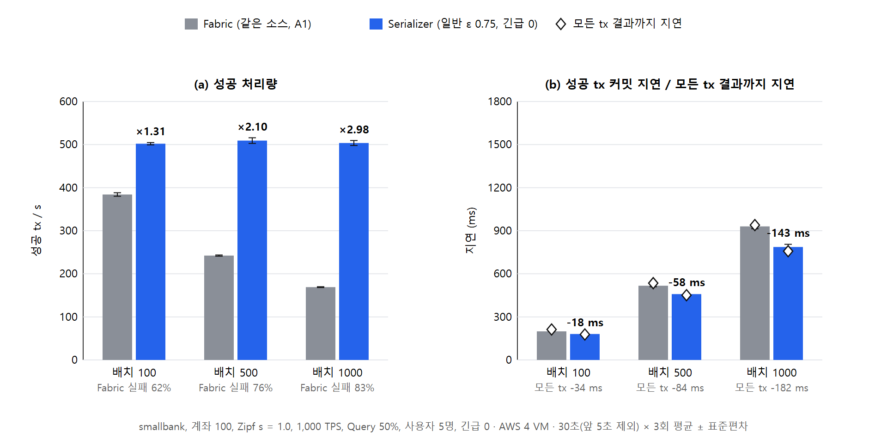
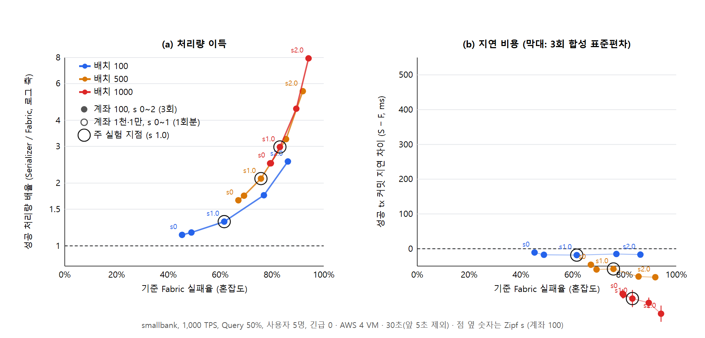
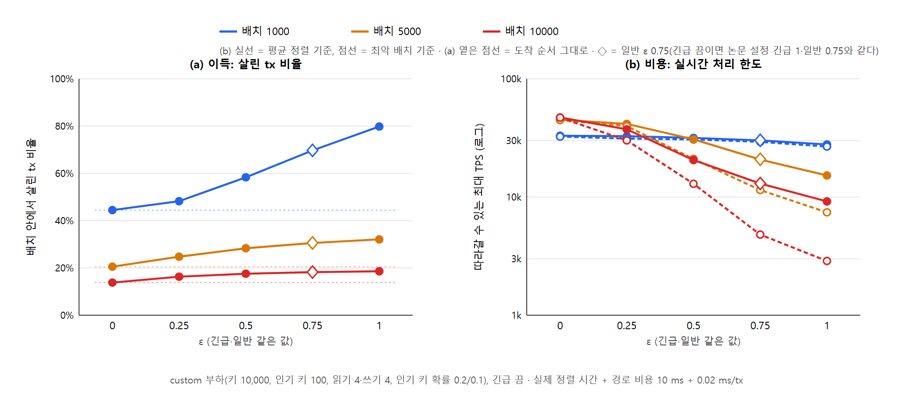
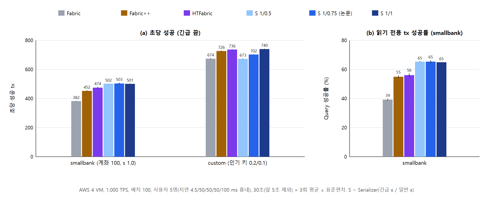
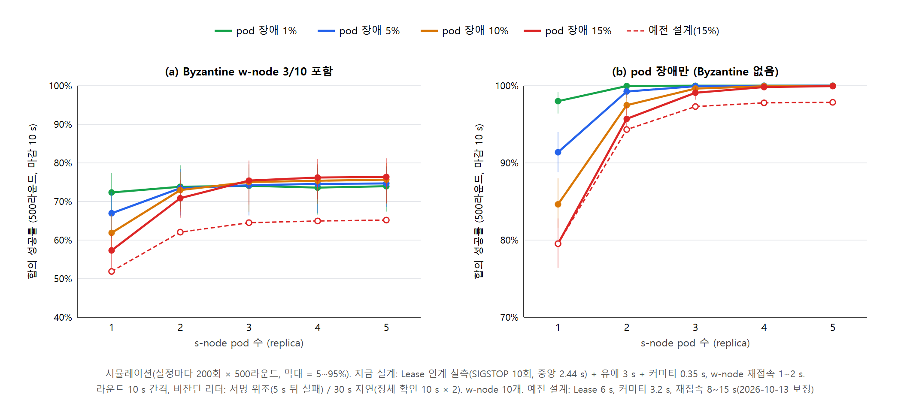

# 결과

[← README](../README.md) · 모든 수치는 이 저장소의 코드로 직접 측정한 값이고, 근거는 [실험 노트](lab-notebook.md)의 § 번호에 있습니다.

> 클라우드 1,000 TPS 결과는 측정 도구(Caliper SDK)의 부담을 고친 뒤 다시 잰 값입니다(§68, §78). 그 전 측정([experiments/01-contention-batch/archive-v1](../experiments/01-contention-batch/archive-v1/README.md))은 Serializer 쪽에 부담이 섞여 불리하게 나왔습니다.

## 배치 크기: Fabric은 무너지고 Serializer는 버틴다

AWS VM 4대, 1,000 TPS, smallbank, Zipf s 1.0, 3회 평균 (§78)

| 배치 | Fabric 성공/s | Serializer 성공/s | 배율 | 커밋 지연 Fabric → Serializer |
|---|---|---|---|---|
| 100 | 384.1 | 502.0 | ×1.31 | 199 → 181 ms |
| 500 | 242.3 | 509.3 | ×2.10 | 517 → 459 ms |
| 1000 | 169.0 | 503.7 | ×2.98 | 930 → 787 ms |

- Fabric은 배치가 커질수록 같은 블록 안의 충돌이 늘어 성공 처리량이 떨어진다. Serializer는 약 500/s를 지킨다.
- **커밋 지연도 모든 조건에서 Serializer가 짧다**(배치 100에서 −11~−18 ms, 1000에서 −130~−187 ms). 무효가 될 tx를 블록에서 빼 피어의 블록 처리가 가볍기 때문이다(배치 1000에서 블록당 259 → 174 ms).

## 혼잡도: 이득은 실제 충돌 정도에 따라 정해진다

- 가로축은 Zipf s가 아니라 **기준 Fabric의 실패율**이다. s와 배치가 달라도 한 축에 놓을 수 있다.
- 측정한 범위(Fabric 실패율 45~94%)의 모든 지점에서 앞선다. 배율은 ×1.13에서 ×7.93까지다.
- 충돌이 적은 구간(Fabric 실패율 15% 이하)은 재측정하지 않았다. 이전 측정(§55)에서는 ×1.00~1.03으로 같았다.

## 읽기 전용 트랜잭션, 블록 낭비, 사용자별 성공

| 배치 (s 1.0) | Query 성공률 Fabric → Serializer | 블록 안 무효 비율 Fabric → Serializer | 먼/가까운 사용자 성공 비 Fabric → Serializer |
|---|---|---|---|
| 100 | 39% → 65% | 62% → 33% | 0.52 → 0.61 |
| 500 | 24% → 81% | 76% → 20% | 0.65 → 0.83 |
| 1000 | 17% → 86% | 83% → 15% | 0.72 → 0.90 |

- 읽기 전용 tx를 블록 맨 앞에 두므로 같은 블록 안에서는 무효가 0이다.
- 충돌할 tx를 블록에 넣지 않으므로, 피어가 검증하는 무효 tx가 1.8~13.9배 준다.
- 다섯 사용자 모두 성공이 늘고, 네트워크가 먼 사용자일수록 더 는다.

## 고부하: 2,000~5,000 TPS (§69~§71, §80)

클라이언트 VM 32 vCPU, 워커 30, s 1.0, 1회 측정

| 조건 | 결과 |
|---|---|
| 배치 100, 2,000 TPS | Serializer 성공 496/s, 커밋 지연 280 ms |
| 배치 1000, 3,000 TPS | Serializer 성공 925/s, 커밋 지연 674 ms |
| 배치 100·1000, 그 이상 | 커밋 지연이 7~25 s로 밀리며 무너진다 |
| 4,000 TPS, 배치 5000 | Serializer 성공 643/s(지연 4.4 s), Fabric 14/s(지연 20.7 s) |

- 정렬 경로(오더러·Kafka·프로세서)는 보낸 만큼 받아 냈다. Kafka 왕복은 7~17 ms였다.
- **무너지는 원인은 피어 CPU다.** 4,000 TPS에서 피어 두 개가 약 11코어를 썼고 Fabric VM(16 vCPU) 전체가 89~95%였다. Fabric도 같은 조건에서 무너진다.
- 피어가 포화된 구간에서도 Serializer는 블록이 작아(2,525 대 4,753 tx) 더 버틴다.

## ε: 더 살리는 것과 실시간성의 맞교환 (§73~§77)

ε는 충돌 그래프로 정렬할 tx의 비율이다. 키우면 더 많이 살리지만 정렬 비용이 초선형으로 는다. 자세한 지표와 그림은 [experiments/02-epsilon-realtime/METRICS.md](../experiments/02-epsilon-realtime/METRICS.md)에 있다.

- **배치가 작으면 큰 ε가 이득이다.** custom 부하, 배치 1000에서 ε 1은 배치 안에서 79.8%를 살린다(ε 0은 44.5%). 클라우드 1,000 TPS에서 실제 성공도 +51%였다(469 대 311/s).
- **배치가 크면 작은 ε가 실시간성을 지킨다.** 배치 10000에서 ε 0.5 이하는 20k TPS까지 1 s 마감을 어기지 않는다(시뮬레이션). ε 1은 10k TPS에서 배치의 67%가 마감을 넘는다.
- **피어 한계에 가까우면 큰 ε가 오히려 해롭다.** 3,000 TPS에서 ε 1은 블록당 유효 tx가 1.8배라 피어 커밋이 밀리고(지연 11.8 s), 성공이 ε 0의 1/4이 됐다(148 대 641/s).
- **긴급 tx:** ε_urgent를 키우면 긴급 tx 생존율이 74%에서 99.7%로 오른다. 비용은 31 ms 이하다.
- 시뮬레이션과 클라우드 실측의 "배치 안 살린 비율"은 0.5%p 안에서 같았다.

## 비교 시스템 (로컬, smallbank)

| 시스템 | 성공/s (긴급 0 / 1) | Query 성공률 | 긴급 tx 성공률 | 사용자 간 sd | 커밋 지연 |
|---|---|---|---|---|---|
| Fabric 2.5 | 94.9 | 38.9% | - | 4.00 | 509 ms |
| Fabric++ | 111.1 / 111.3 | 56.4% | 32.1% | **1.48** | 574 ms |
| HTFabric (WARD) | 115.6 / 118.6 | 56.9% | 32.5% | 4.54 | 570~602 ms |
| **Serializer** | **126.0 / 123.5** | **67.4%** | **43.9%** | 3.62 | 563 ms |

Fabric++와 HTFabric은 같은 프로세서 자리에 논문대로 구현해 같은 부하로 비교했습니다. 전체 표와 보조 부하(custom) 결과는 [summary.md](summary.md) §5에 있습니다.

## 비교 시스템과 사용자 공정성 (클라우드, §84~§85)

AWS VM 4대, 1,000 TPS, 배치 100, Zipf s 1.0, 3회. 자세한 내용은 [experiments/04-fairness-algos](../experiments/04-fairness-algos/README.md)에 있습니다.

| 긴급 끔 | Fabric | Fabric++ | HTFabric | **Serializer** (일반 ε 0.75) |
|---|---|---|---|---|
| smallbank 성공/s | 382 | 452 | 474 | **503** |
| smallbank Query 성공률 | 39% | 55% | 56% | **65%** |
| custom 성공/s (일반 ε 1이면 740) | 674 | 726 | 736 | 702 |
| smallbank 사용자 공정성 (Jain) | 0.946 | **0.994** | 0.973 | 0.988 |

- smallbank 처리량은 Serializer가 가장 높습니다(Fabric 대비 +32%, Fabric++ +11%, HTFabric +6%). 긴급 tx 성공률도 +10%p 높습니다.
- 공정성은 Fabric++가 가장 좋습니다. 블록 안 위치를 분석해 보니, Fabric++는 가까운 사용자의 tx를 정렬 단계에서 더 많이 버려 결과가 평평해집니다. Serializer는 사용자마다 블록에 넣는 수가 같습니다.

## 추가 이점: 실패 통보, 자원, 쏠린 사용자 (클라우드, §86)

자세한 내용은 [experiments/07-extra-advantages](../experiments/07-extra-advantages/README.md)에 있습니다.

- **실패를 더 빨리 안다.** 실패를 알기까지 평균 153 ms로 Fabric(226 ms)보다 짧습니다(smallbank, 배치 100). 실패의 78%를 프로세서가 미리 통보하기 때문입니다.
- **성공 tx당 자원이 적다.** smallbank에서 성공 tx당 피어 CPU 7.54 ms(Fabric 9.76), 원장 5.96 KB(Fabric 10.39)입니다. 원장에 쌓이는 무효 tx는 33.7%(Fabric 61.9%)입니다.
- **한 사용자만 인기 계좌에 몰리면 그 사용자는 어느 시스템에서도 보호되지 않습니다**(쓰기 성공 7~9%). α를 바꿔도 같습니다. 대부분 같은 배치의 앞선 쓰기를 읽어 버려지는데, 이 검사에는 α가 쓰이지 않기 때문입니다.

## 검증 노드 장애 복구 (MTTR)

MTTR은 장애가 난 때부터 **모든 w-node가 새 커미티를 받아 합의를 다시 할 수 있을 때까지**로 정의했습니다.

| 장애 | 이전 (Lease 6 s) | 현재 (Lease 2 s + 수정) | Lease 1 s (기각) |
|---|---|---|---|
| 강제 종료 (SIGKILL) | 10.8 s | **5.4 s** (4.6~5.9) | 2.9~4.3 s |
| 멈춤 (SIGSTOP) | 11.8 s | **5.4 s** (5.0~6.3) | 3.5~4.3 s |
| 정상 종료 | 5.1 s, 1회 복구 실패 | 5.6 s, 10/10 | 4.0~5.1 s |

2026-10-19에 현재 설정으로 다시 측정한 중앙값은 정상 종료 4.79 s, SIGKILL 4.49 s, SIGSTOP 5.77 s입니다(유형마다 10회, [experiments/03-snode-mttr](../experiments/03-snode-mttr/README.md)).

### 합의 성공률: s-node pod 수 × pod 장애 확률 (§87)

이 실측값으로 보정한 시뮬레이션에서 합의 성공률을 계산했습니다(w-node 10개 중 비잔틴 3개, 500라운드, 마감 10 s, 설정마다 200회). 자세한 내용은 [experiments/06-consensus-sim](../experiments/06-consensus-sim/README.md)에 있습니다.

- pod 장애만 있을 때(15%): pod 1개 79.5%, 3개 99.1%, 5개 100%입니다.
- 비잔틴 w-node가 있으면 약 75%에서 포화합니다. 원 실험의 결론과 같습니다.
- 현재 설계는 이전 설계보다 비잔틴 포함 조건에서 10~11%p 높습니다. 커미티를 만드는 시간이 짧아졌기 때문입니다.

## 비용과 한계

결과가 불리한 경우도 그대로 적었습니다.

- **피어 처리 한계:** 이 구성(Fabric VM 16 vCPU)에서는 배치 100에서 약 2,000 TPS, 배치 1000에서 약 3,000 TPS를 넘으면 무너진다. Fabric도 4,000 TPS에서 무너졌다(2,000~3,000 TPS의 Fabric은 재지 않았다).
- **큰 ε의 비용:** 정렬 시간뿐 아니라, 더 많이 살린 tx를 피어가 커밋하는 부담도 있다. 고부하에서는 작은 ε가 낫다.
- **부하에 따라 다른 이득:** smallbank(계좌 100, 키 200개)에서는 ε를 키워도 살리는 tx가 늘지 않는다. 이 부하에서 이득은 주로 읽기 전용을 앞에 두고 충돌할 tx를 블록에서 빼는 데서 나온다. 재정렬로 살릴 여지가 큰 custom 부하에서는 ε의 효과가 크다.
- **보조 부하(custom)에서는 원 실험의 일반 ε 0.75로 HTFabric에 진다**(로컬 87.3 대 107.9/s, 클라우드 702 대 736/s). 일반 ε을 1로 두면 비슷해진다(로컬 111.5/s, 클라우드 740/s).
- **공정성(사용자 간 편차)은 로컬·클라우드 비교 모두 Fabric++가 가장 좋다.** Serializer가 그다음이다.
- **인기 키에 몰리는 사용자 보호:** 한 사용자만 인기 계좌에 몰리면 α로도 보호되지 않는다(§86). 보호하려면 설계 변경이 필요하다.
- **측정 범위:** 비교 시스템과의 비교는 단일 PC(상한 약 400 TPS)에서 했다. HTFabric은 정렬(WARD)만 비교했고 피어 쪽 재실행(TSP)은 뺐다. 고부하 결과는 1회 측정이다.

## 확장 실험에서 추가로 확인한 것

측정 범위를 넓혀(Zipf s 0~2, 배치 100~10000, 클라우드 1,000~5,000 TPS, 장애 유형별 반복) 다시 측정했습니다.

| 항목 | 원 실험 | 확장 실험 결과 |
|---|---|---|
| 이득이 나타나는 혼잡도 | s > 1.15 구간에서 앞섬 | s 0~2 전체에서 앞섬. 로컬 균등 분포(s 0)에서도 +9~11%, 클라우드 s 0에서 ×1.13~2.49 |
| 외부 정렬의 추가 지연 | 약 +50 ms | 클라우드 재측정에서는 오히려 Fabric보다 짧음(−11~−187 ms). 무효 tx를 뺀 블록이 가볍기 때문 |
| 검증 노드 복구 시간 | 350 ms (시뮬레이션 설정값) | 실제 구조에서 "모든 w-node가 다시 합의할 수 있을 때까지"를 측정해 4.5~5.8 s (활성 pod 전환만은 0.6~2.4 s). 이 값으로 다시 계산한 합의 성공률도 원 실험과 같은 경향(pod 3개 이상에서 포화, 비잔틴 포함 약 75%) |
| ε 설정 | 긴급 1 / 일반 0.75 (긴급 tx 비율 10%) | 부하·배치에 따라 고른다. 배치가 작고 부하가 여유로우면 ε 1(성공 +51%), 배치가 크거나 피어 한계에 가까우면 작은 ε |

비교 논문을 구현하면서 찾은 문제도 있습니다. HTFabric 의사코드의 in/out-degree가 정의와 반대로 되어 있었고, Fabric++의 고리 열거는 2,000건 배치에 80초가 걸려 Johnson 알고리즘으로 바꿨습니다(결과는 같음).
