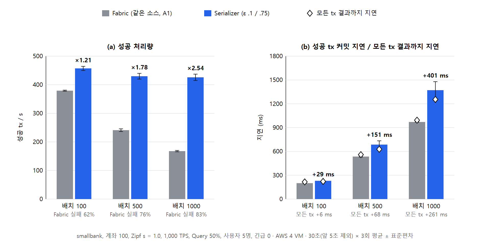
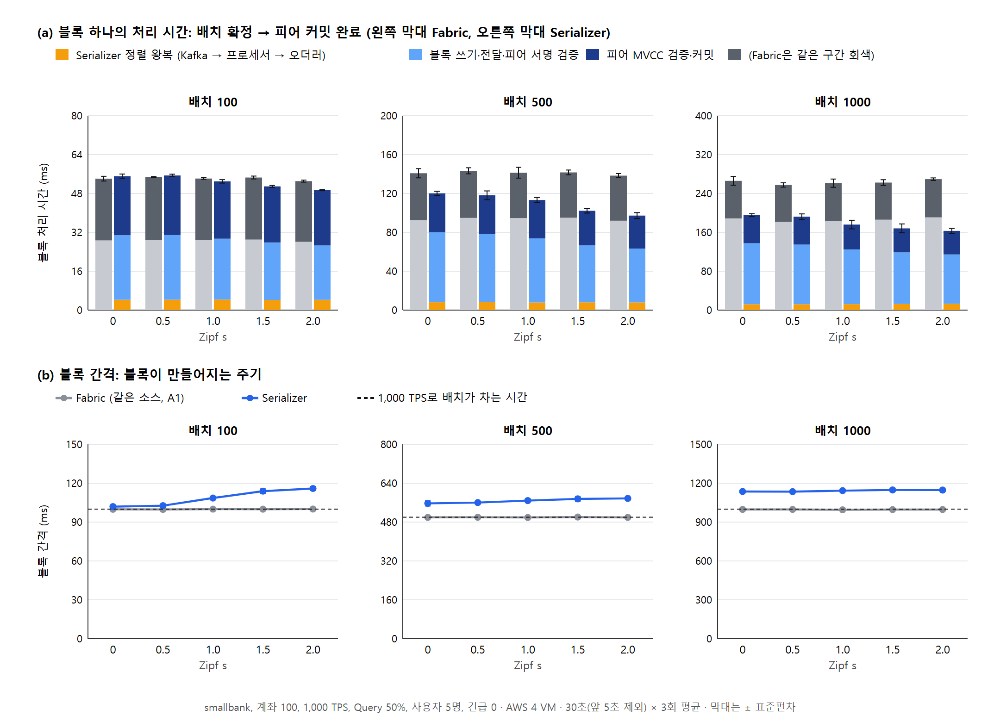
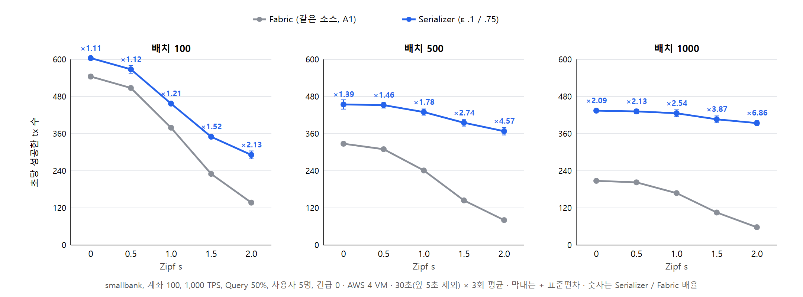
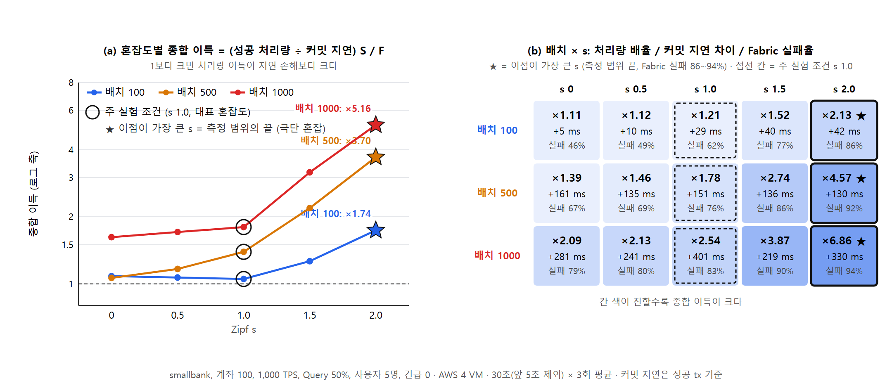
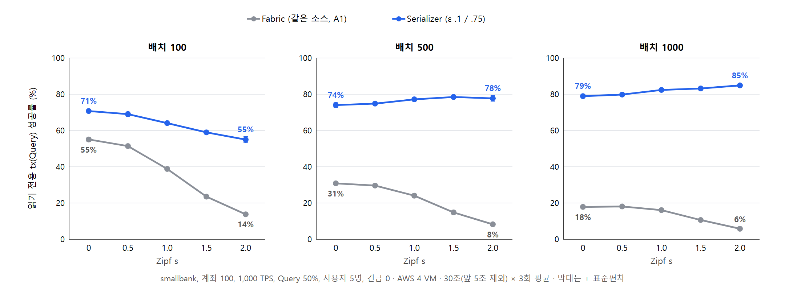
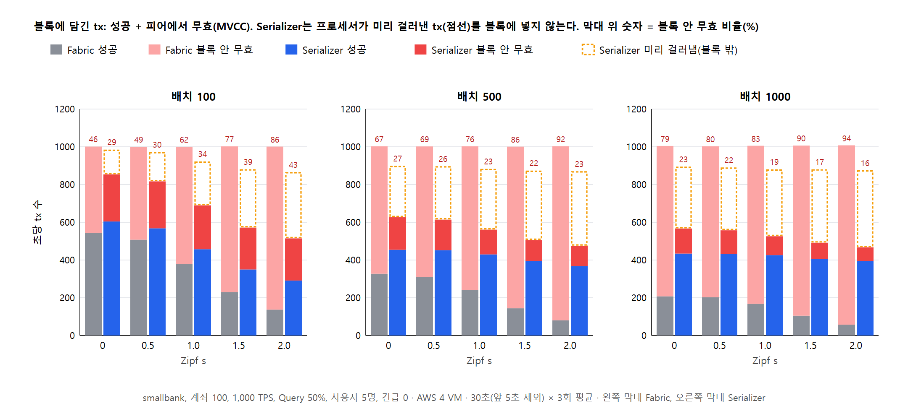
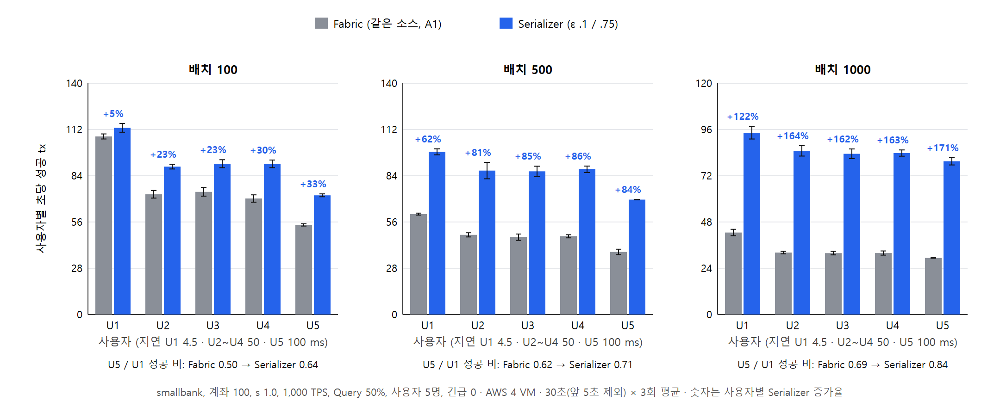
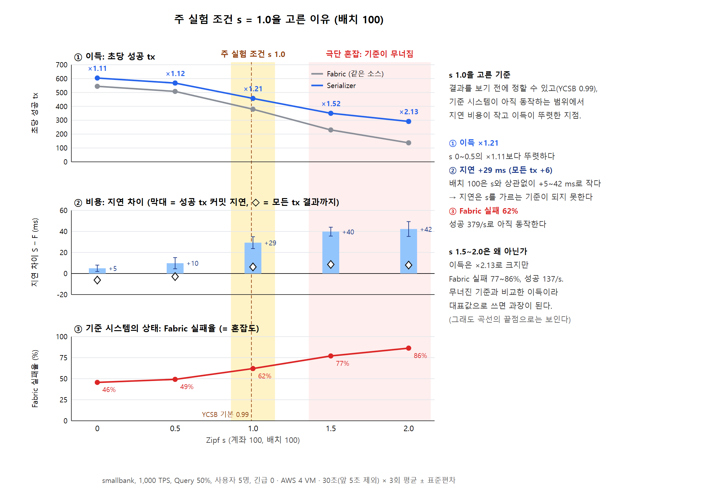

# 클라우드 1,000 TPS 실험 그림 (NOTES §54~§56)

> **주의 (2026-10-18, NOTES §68):** 이 폴더의 Serializer 수치는 Caliper 워커의 Fabric SDK 부담(abort된 tx의 커밋 리스너가 쌓여 워커 CPU가 포화됨)이 섞여 **Serializer에 불리하게** 나왔다. 보낸 TPS 867~986, 배치 100의 지연 +5~42 ms, 블록 간격이 길다는 것이 그 영향이다. 수정 후 s 2.0·배치 100에서 Serializer는 1,004 TPS를 보냈고, 성공 342/s, 커밋 지연 175 ms였다(수정 전 849 / 279 / 244 ms). Fabric은 그대로였다. 다시 잰 뒤 그림을 바꿔야 한다.

- 그림은 `bench/scripts/cloudfigs.js`로 만든다.
  - 원자료는 `bench/zipfbench/results/cloud/`에 있다.
  - 그림에 쓴 값은 `fig-data.json`에 있다.
  - 다시 만들려면 `node cloudfigs.js`를 실행한다.
- 파일
  - 논문용 벡터: `*.svg`
  - 미리보기: `*.png` (Edge headless로 2배 해상도)

## 공통 조건

| 항목 | 값 |
|---|---|
| 환경 | AWS 서울 VM 4대 (Fabric / Caliper / Kafka+프로세서 / s-node·w-node) |
| 부하 | smallbank, 1,000 TPS, 사용자 5명(지연 4.5/50/50/50/100 ms), Query 50%, 긴급 0 |
| 비교 | Fabric = 같은 소스 Fabric(A1), Serializer = ε_urgent 0.1 / ε_low 0.75 |
| 측정 | 30초 실행 중 앞 5초를 뺀 정상 구간. 계좌 100은 3회 평균 ± 표준편차 |
| 반복 순서 | 묶음과 s 순서를 섞었다. 같은 묶음 안에서는 네트워크를 재사용했다(새로 띄운 것과 0.3% 차이) |
| 성공 처리량 | 커밋에 성공한 tx 수 / 정상 구간 초 |
| 커밋 지연 | 성공한 tx의 제출부터 커밋 통보까지 |
| 모든 tx 지연 | 실패를 포함해 클라이언트가 결과를 받기까지(통보 실패는 빨리 끝난다) |

## 그림 구성 결정 (2026-10-18)

**배치마다 s를 따로 고르지 않고 s = 1.0으로 고정한다.**

1. **배치 실험의 목적은 배치 크기의 효과다.** 배치 말고 다른 조건은 고정해야 한다. 배치마다 s를 바꾸면 이득이 배치 때문인지 혼잡 때문인지 가를 수 없다.
2. **s를 고정해도 배치가 크면 혼잡은 저절로 커진다.** Fabric 실패율은 배치 100에서 62%, 500에서 76%, 1000에서 83%다. 이 증가가 바로 배치 효과다.
3. **s 1.0은 미리 정할 근거가 있다.** YCSB 기본 Zipfian 상수 0.99와 같은 범위다. 배치별 최적 s는 결과를 보고 고른 값이라 "유리한 지점만 골랐다"는 지적을 받기 쉽다.

**높은 s의 큰 이득은 그림 B의 곡선으로 보인다.**
- 표만 보면 배치 500은 s 2.0, 배치 1000은 s 1.5~2.0이 가장 좋아 보인다(사용자 지적).
- 이것은 그림 B의 곡선 끝점으로 그대로 보인다.
- 그래서 따로 골라 쓸 필요가 없다.

## 그림 A: 배치 효과 (s = 1.0 고정)

| 배치 | Fabric 실패율 | Fabric 성공/s | Serializer 성공/s | 배율 | 커밋 지연 F → S (ms) | 차이 | 모든 tx 지연 차이 |
|---|---|---|---|---|---|---|---|
| 100 | 62% | 379.3 ± 1.8 | 457.1 ± 7.2 | ×1.21 | 201 → 230 | +29 | +6 |
| 500 | 76% | 241.0 ± 4.7 | 429.8 ± 9.9 | ×1.78 | 535 → 686 | +151 | +68 |
| 1000 | 83% | 167.8 ± 2.3 | 425.9 ± 11.1 | ×2.54 | 971 → 1372 | +401 | +261 |

- **Fabric은 배치가 커질수록 성공 처리량이 무너진다.** 379에서 168로 떨어진다. 같은 배치 안의 충돌이 늘어 MVCC 실패가 커지기 때문이다.
- **Serializer는 426~457로 거의 그대로다.** 그래서 배율이 1.21에서 2.54로 커진다.
- **비용은 지연이다.**
  - 배치 100에서는 커밋 지연이 +29 ms이고, 모든 tx 기준으로는 +6 ms다. 사실상 같다.
  - 배치 500에서는 커밋 지연이 +151 ms다.
  - 배치 1000에서는 커밋 지연이 +401 ms다. Serializer 편차가 ±약 110 ms로 커서 이 차이는 흔들림이 크다.
- **원인.** 배치 1000에서는 배치 간격이 1.4초까지 늘어난다. 오더러가 배치 하나씩 주고받기(lock-step) 때문이다. 원인 분리는 아직 못 했다(NOTES §54).

## 그림 B: 혼잡도에 따른 이득과 지연 비용

- **가로축은 Zipf s가 아니라 "기준 Fabric의 실패율"이다.** 실제 충돌 정도를 나타내므로 계좌 수·s·배치가 달라도 한 축에 놓을 수 있다.
- **점의 종류**
  - 채운 점: 계좌 100, s 0 / 0.5 / 1.0 / 1.5 / 2.0, 3회.
  - 빈 점: 계좌 1천·1만, s 0~1.0, 1회분이다. 배치 100과 1000만 있다.
  - 큰 원: 주 실험 지점(s 1.0).

**(a) 처리량 이득**
- 모든 지점에서 배율이 1 이상이다. 역전 지점은 없다.
- 실패율 15% 이하에서는 1.00~1.03배로 같다.
- 30~50%에서는 1.06~1.22배다.
- 60% 이상에서는 급격히 커져 실패율 94%에서 6.86배가 된다.
- 같은 실패율이면 배치 크기와 상관없이 곡선이 거의 겹친다. 즉 이득은 배치 자체보다 실제 충돌 정도에 따라 정해진다.

**(b) 지연 비용**
- 배치 100: −10 ~ +42 ms. 실패율 50% 이하에서는 오히려 같거나 짧다.
- 배치 500: +130 ~ +161 ms. 혼잡과 거의 상관이 없다.
- 배치 1000: 충돌이 거의 없어도 +53 ms, 혼잡하면 +220 ~ +415 ms다. 3회 편차가 ±100 ms 안팎이라 s끼리의 순서는 의미가 없다.

| Fabric 실패율 | 조건 (배치 100) | 배율 | 커밋 지연 차이 |
|---|---|---|---|
| 1~15% | 계좌 1만·1천, s 0~0.5 (1회) | 1.00~1.02× | −6~−10 ms |
| 31~49% | 계좌 1만 s1 / 1천 s1 / 100 s0~0.5 | 1.06~1.12× | +5~+13 ms |
| **62%** | **계좌 100, s 1.0 (3회)** | **1.21×** | **+29 ms** |
| 77% | 계좌 100, s 1.5 | 1.52× | +40 ms |
| 86% | 계좌 100, s 2.0 | 2.13× | +42 ms |

## 논문에 쓸 때

- 주 비교는 그림 A(s 1.0)로 한다. 혼잡도에 따른 변화는 그림 B로 보인다. 그림 B에는 s 0~2 전체가 들어간다.
- 높은 s의 큰 배율은 "Fabric 실패율 86~94%라는 극단 조건"이라고 실패율과 함께 적는다.
  - 배치 500의 s 2.0은 ×4.57, 배치 1000의 s 2.0은 ×6.86이다.
- 지연은 "성공 tx 커밋 지연"과 "모든 tx 결과까지 지연"을 함께 적는다.
  - 모든 tx 지연만 적으면 빨리 끝나는 통보 실패가 평균을 낮춘다. Serializer 쪽 tx의 37~47%가 통보 실패다.
- 저충돌 구간(빈 점)은 1회분이다. 확정하려면 반복이 필요하다(약 25분).
- Serializer는 혼잡할 때 1,000 TPS를 다 받지 못한다(867~986 TPS). 성공 처리량에는 이미 반영되어 있다.

---

# 그림 1~3: s에 따른 비교 (2026-10-18, 사용자 요청, NOTES §57)

- 원자료는 §54의 계좌 100, s 0~2 × 배치 100/500/1000, 3회 결과다.
- 생성 스크립트는 `bench/scripts/cloudfigs2.js`다. 블록 시각 분해는 `blocktime.js`에서 한다.
- 그림에 쓴 값은 `fig123-data.json`에 있다.

## 그림 1: 블록당 처리 시간

**(a) 블록 하나의 처리 시간** = 배치가 확정된 뒤 피어 커밋이 끝날 때까지다. 오더러와 피어 로그로 블록마다 잰다. 두 컨테이너는 같은 VM에 있어 시계가 같다.
- **정렬 왕복** (Serializer만): 오더러의 Kafka 전송 확인부터 블록 생성까지.
  - 전송 확인 이전의 전송 시간은 빠져 있어 조금 작게 잡힌다.
- **블록 쓰기·전달**: 블록 생성부터 피어 수신까지. 피어 수신 시각 = 커밋 끝 − 피어 커밋 시간.
- **피어 검증·커밋**: 피어 로그의 `in Xms`.

**(b) 블록 간격** = 연속한 블록 생성 사이의 시간이다. 점선은 1,000 TPS로 배치가 차는 시간(배치 크기 ms)이다.

| 배치 | s | 블록 처리 F / S (ms) | S 내역: 정렬+전달+커밋 | 블록 간격 F / S (ms) | 블록당 tx F / S |
|---|---|---|---|---|---|
| 100 | 0 | 54 / 55 | 4+27+24 | 100 / 102 | 100 / 87 |
| 100 | 1.0 | 54 / 53 | 4+25+24 | 100 / 109 | 100 / 75 |
| 100 | 2.0 | 53 / 49 | 4+22+23 | 100 / 116 | 100 / 59 |
| 500 | 0 | 141 / 120 | 8+72+40 | 499 / 557 | 500 / 348 |
| 500 | 1.0 | 141 / 113 | 8+66+39 | 499 / 568 | 500 / 317 |
| 500 | 2.0 | 138 / 97 | 8+55+34 | 499 / 577 | 500 / 273 |
| 1000 | 0 | 266 / 195 | 12+126+58 | 998 / 1136 | 1000 / 631 |
| 1000 | 1.0 | 261 / 176 | 12+113+51 | 995 / 1142 | 1000 / 596 |
| 1000 | 2.0 | 269 / 163 | 13+101+48 | 997 / 1147 | 1000 / 532 |

0.5와 1.5를 포함한 전체 값은 `fig123-data.json`에 있다.

**블록 하나의 처리 시간은 Serializer가 같거나 더 짧다.**
- 배치 100에서는 같고, 배치 500·1000에서는 20~40% 짧다.
- Serializer 블록에는 정렬된 tx만 들어가고 abort된 tx는 빠진다. 그래서 블록이 작고 쓰기·전달·검증이 빠르다.
- Fabric 블록은 실패할 tx까지 모두 담아 검증한다.
- 정렬 왕복은 4 / 8 / 12 ms로 작다.

**대신 블록 간격이 길다.**
- 배치 100에서 +2~16%, 500에서 +12~16%, 1000에서 +14~15%다.
- 처음에는 lock-step 대기 때문이라고 봤으나, §59에서 대기 자체는 6~16 ms뿐임을 확인했다. 늘어난 간격은 다음 배치가 차는 구간에 있다(오더러에 들어오는 tx가 초당 약 880~900건).
- 이 때문에 1,000 TPS를 다 받지 못하고(867~986 TPS), 커밋 지연이 늘어난다.
- 늘어난 간격(배치 1000에서 약 140 ms)은 잰 정렬 왕복(12 ms)보다 훨씬 크다. 나머지는 계측하지 않은 오더러 안쪽에서 생긴다(메타데이터 추출, Kafka 전송 확인 전까지의 시간). 아직 나누지 못했다.

## 그림 2: 초당 성공한 tx 수

- 모든 s, 모든 배치에서 Serializer가 앞선다.
- Fabric은 s가 커질수록 크게 떨어진다. 배치 100에서 544 → 137, 배치 1000에서 208 → 58이다.
- Serializer는 완만하게 떨어진다. 배치 100에서 604 → 291이고, 배치 500·1000에서는 360~450으로 거의 평평하다.
- 배율은 s와 배치가 클수록 커진다(×1.11 → ×6.86).

## 그림 3: 혼잡도별 종합 이득 — 이점이 가장 큰 s(★)와 주 실험 조건 s 1.0(○)

**기준: 종합 이득**
- 처리량 이득과 지연 손해를 함께 보려고 Kleinrock power(성공 처리량 ÷ 커밋 지연)의 비 = (S 처리량 / S 지연) ÷ (F 처리량 / F 지연)을 쓴다.
- 1보다 크면 처리량 이득이 지연 손해보다 크다.

**결과: 세 배치 모두 s 2.0에서 이점이 가장 크다(★). 이것은 "주 실험에 쓸 s"가 아니다. 주 실험 조건은 s 1.0(○)이다.**

- **★는 고를 기준이 될 수 없다.** 역전이 없어 측정 범위의 끝이 늘 ★가 되고, s를 더 키우면 ★도 따라 움직인다. 그 지점은 Fabric 실패율 86~94%의 극단 조건이다.
- **s 1.0을 고른 근거는 그림 밖에 있다.** 미리 정할 수 있는 외부 기준(YCSB 기본값 0.99), 중간 혼잡(Fabric 실패율 62~83%), 배치 100에서 지연 손해가 거의 없다는 점(+29 ms)이다.
- **그림 3의 역할:** 대표 조건(s 1.0)의 이점이 곡선 위 어디쯤인지와, 혼잡하면 더 커진다는 상한을 함께 보여 준다.

| 배치 | 최적 s | 종합 이득 | 처리량 배율 | 커밋 지연 차이 | Fabric 실패율 |
|---|---|---|---|---|---|
| 100 | 2.0 | ×1.74 | ×2.13 | +42 ms | 86% |
| 500 | 2.0 | ×3.70 | ×4.57 | +130 ms | 92% |
| 1000 | 2.0 | ×5.16 | ×6.86 | +330 ms | 94% |

**해석과 주의점**
- **"최적 s" = 가장 혼잡한 지점이다.** 역전 지점이 없어서 혼잡할수록 Serializer의 이점이 커진다. 측정한 범위의 끝(s 2.0)이 언제나 최적이 된다. s를 더 키우면 최적점도 따라 움직일 가능성이 크다.
- **s는 시스템 설정값이 아니라 워크로드의 성질이다.** 따라서 "최적 s"는 "Serializer의 이점이 가장 크게 드러나는 워크로드"라는 뜻이다. 운영자가 고르는 값이 아니다.
- **지연 손해만 기준으로 하면 다르다.** 배치 100은 s 0(+5 ms), 500은 s 2.0(+130 ms), 1000은 s 1.5(+219 ms)다.
  - 배치 1000은 s끼리의 차이가 3회 편차(±75~112 ms) 안이라 구분되지 않는다.
- **같은 s라도 배치가 크면 종합 이득이 크다.** 배치 100의 s 1.0 이하에서는 지연 손해 때문에 종합 이득이 ×1.05~1.08로 거의 같다. 처리량 배율은 ×1.11~1.21이다.
- 그림 A·B(s 1.0 고정)와 함께 쓰면 "대표 조건(s 1.0)에서의 비교"와 "이점이 가장 큰 조건(s 2.0)"을 모두 보일 수 있다.

### 보충: "블록 쓰기·전달" 구간이 Fabric에서 더 긴 이유 (NOTES §58)

**구간 이름을 고쳤다.** 이 구간에는 피어의 서명·보증 정책 검증(VSCC)이 들어간다. 그래서 그림 1의 이름을 "블록 쓰기·전달·피어 서명 검증"으로 바꿨다.
- 피어 로그의 `Committed block … in Xms`는 MVCC 검증과 저장만 잰다. 그 앞에서 하는 tx별 서명·보증 정책 검증은 X에 들어가지 않는다.
- 블록 생성 → 피어 수신을 "커밋 끝 − X"로 계산했기 때문에, 서명·정책 검증 시간이 이 구간에 섞였다.

**구간을 더 나눈 결과** (s 1.0)

| 배치 | 블록당 tx F / S | 생성 → 오더러 원장 쓰기 F / S | 쓰기 → 피어 MVCC 시작 F / S |
|---|---|---|---|
| 100 | 100 / 75 | 5.7 / 5.6 ms | 23.3 / 19.3 ms |
| 500 | 494 / 314 | 9.9 / 8.3 ms | 83.8 / 56.6 ms |
| 1000 | 970 / 591 | 16.8 / 11.3 ms | 161.8 / 100.0 ms |

**두 시스템 모두 같은 직선 위에 있다.** 블록 6,816개를 회귀하면 "쓰기·전달·서명 검증 ≈ 11.4 ms + 0.172 ms × 블록의 tx 수"이고, R²는 0.974다.
- tx 하나당 비용은 두 시스템이 같다. 차이는 블록에 든 tx 수에서만 나온다.
- Fabric 블록에는 나중에 MVCC로 무효가 될 tx까지 모두 들어간다. 무효가 될 tx도 서명 검증은 다 받는다.
- Serializer는 프로세서가 abort한 tx를 블록에서 뺀다. 그래서 블록이 25~45% 작다.
- 오더러와 피어는 같은 VM이라 네트워크 전달은 거의 0이다. tx당 0.17 ms는 서명 검증(보증 서명 2개 + 제출자 서명)으로 본다.
  - 이것은 추정이다. 피어의 `Validated block … in Xms` 줄을 수집하지 않았기 때문이다. 다음 실험에서 그 줄을 함께 모으면 확정할 수 있다.

---

# Serializer 장점 검토와 그림 4~6 (2026-10-18, NOTES §60)

- 지금까지의 결과에서 Serializer의 장점으로 그림을 그릴 수 있는 것을 검토했다.
- 원자료는 클라우드 §54(계좌 100, s 0~2 × 배치 100/500/1000, 3회)다. 같은 환경이고 반복이 있어 근거가 가장 단단하다.
- 스크립트는 `bench/scripts/cloudfigs3.js`이고, 그림에 쓴 값은 `fig456-data.json`에 있다.

## 검토 결과

| 장점 후보 | 판단 | 그림 | 근거 (s 1.0 / 범위) |
|---|---|---|---|
| 초당 성공 tx | **강함** | 그림 2, A, B | ×1.21 / ×1.78 / ×2.54 (전체 ×1.11~×6.86) |
| 읽기 전용(Query) 성공률 | **강함** | **그림 4** | 39→64%, 24→77%, 16→82% (Fabric 6~55% → S 55~85%) |
| 블록 낭비 감소 (무효 tx를 블록에 덜 넣음) | **강함** | **그림 5**, 그림 1(a) | 블록 안 무효 비율 62→34%, 76→23%, 83→19%. 무효 tx 621→233/s, 762→131/s, 838→100/s |
| 블록 하나의 처리 시간 | 중간 | 그림 1(a) | 배치 500·1000에서 20~40% 짧음(블록이 작아서). 배치 100은 같음 |
| 모든 사용자가 이득, 먼 사용자일수록 더 큼 | **강함** | **그림 6** | 모든 사용자 증가. U5(100 ms)/U1(4.5 ms) 성공 비 0.50→0.64, 0.62→0.71, 0.69→0.84 |
| 실패를 빨리 알림 | 약함(섞임) | 그리지 않음 | 프로세서가 걸러낸 실패는 Fabric 실패보다 15~35% 빨리 알려진다(159 대 225 ms, 418 대 567, 875 대 998). 그러나 피어에서 무효가 된 실패는 오히려 1.1~2배 늦다. 평균하면 비슷하다 |
| 지연 | 장점 아님(비용) | 그림 A, B(b) | 배치 100에서만 같다. 500·1000에서 +130~400 ms |
| 사용자 간 표준편차 | 쓰지 않음 | — | Fabric은 성공 자체가 작아 표준편차도 작게 나온다. 비율(U5/U1)로 대신 보였다 |

**클라우드 밖의 장점** (로컬 결과라 환경이 다르다. 쓰려면 조건을 밝혀야 한다)
- 긴급 tx 성공률: 로컬 250 TPS(§40)에서 Serializer 43.9%, WARD 32.5%, Fabric++ 32.1%. 클라우드에서는 긴급 0으로 재서 데이터가 없다. 클라우드에서 긴급 비율을 켜고 다시 재는 것을 권한다.
- Fabric++ / HTFabric(WARD)와의 비교: 로컬 smallbank에서 Serializer가 처리량, Query, 긴급 모두 최고였다(§40). 클라우드에서는 같은 소스 Fabric과만 비교했다.
- s-node 장애 복구(MTTR 5.4 s, 잘못된 전환 0회, §48~§49): 정렬 성능과 다른 축이다. 표로 이미 정리되어 있다(PROJECT_SUMMARY §9).

## 그림 4: 읽기 전용 tx(Query) 성공률

- **Fabric:** 같은 블록의 쓰기 뒤에 놓인 읽기가 MVCC로 무효가 된다. 그래서 s와 배치가 클수록 떨어져 배치 1000, s 2.0에서는 6%까지 내려간다.
- **Serializer:** 읽기 전용 tx를 블록 맨 앞에 둔다. 그래서 같은 블록 안에서는 무효가 0이다.
- **배치가 클수록 오히려 오른다**(71~85%). 블록 수가 줄어 배치 사이에 낡는 일이 적기 때문이다.
- 남은 실패(15~45%)는 이전 블록 때문에 생긴 낡은 읽기다(§34).

## 그림 5: 블록에 담긴 tx 구성

- **Fabric:** 받은 tx를 모두 블록에 넣는다(막대 높이 약 1,000/s). 그중 46~94%가 피어에서 무효가 된다. 무효 tx도 서명 검증, MVCC 검사, 원장 저장을 모두 거친다.
- **Serializer:** 충돌할 tx를 프로세서가 미리 걸러 블록 밖에 둔다(점선). 블록 안 무효 비율은 16~43%다.
  - 배치 1000에서는 혼잡할수록 오히려 줄어든다(23→16%).
- **피어가 무효 tx에 쓰는 일이 2~13배 줄어든다.** 무효 tx는 초당 457~950건에서 73~250건이 된다.
  - §58 회귀(tx당 0.17 ms)로 환산하면, 배치 1000·s 2.0에서 피어가 무효 tx 검증에 쓰는 시간은 초당 약 160 ms에서 약 12 ms로 준다.

## 그림 6: 사용자별 초당 성공 tx (s 1.0)

- 다섯 사용자 모두 Serializer에서 더 많이 성공한다. 손해 보는 사용자가 없다.
- **멀리 있는 사용자일수록 증가율이 크다.** 배치 100에서 U1(4.5 ms)은 +5%, U5(100 ms)는 +33%다.
- 그 결과 가장 먼 사용자와 가장 가까운 사용자의 격차가 줄어든다. U5/U1 성공 비는 0.50→0.64, 0.62→0.71, 0.69→0.84다.
- **이유:** Fabric에서는 늦게 도착한 tx가 블록 뒤쪽에 놓여 앞의 쓰기와 충돌해 무효가 되기 쉽다. Serializer는 도착 순서가 아니라 충돌 관계로 순서를 다시 정하므로, 늦게 도착했다는 이유만으로 불리해지지 않는다.

## 논문에 넣을 그림 제안

- **본문:** 그림 2(성공 tx), 그림 4(Query), 그림 5(블록 낭비), 그림 A 또는 그림 3(배치·혼잡 효과)
- **보조:** 그림 6(사용자별), 그림 1(블록 처리 시간과 간격, 비용 설명용)
- **비용 쪽은 숨기지 않는다:** 그림 A(b)와 그림 B(b)의 지연, 그리고 혼잡할 때 1,000 TPS를 다 받지 못한다는 점(§59)

---

## 그림 7: 주 실험 조건 s = 1.0을 고른 이유 (NOTES §64)

- **목적:** 그림 3만 보면 이득이 가장 큰 s 2.0을 두고 왜 1.0을 골랐는지 드러나지 않는다(사용자 지적). 그래서 고른 이유를 한 그림에 모았다.
- **데이터:** 배치 100(주 실험 배치), 계좌 100, 3회.
- **스크립트:** `bench/scripts/cloudfig-choice.js`. `fig-data.json`을 읽는다.

**같은 s 축에 세 행을 놓았다**
1. **이득:** 초당 성공 tx와 배율.
2. **비용:** 지연 차이. 막대는 성공 tx 커밋 지연, ◇는 모든 tx 결과까지의 지연이다.
3. **기준 시스템의 상태:** Fabric 실패율.

**선택 기준:** 결과를 보기 전에 정할 수 있는 값(YCSB 0.99) 가운데, 기준 Fabric이 아직 동작하는 범위에서 이득이 뚜렷한 지점이다.
- **① 이득:** s 1.0의 ×1.21은 s 0~0.5의 ×1.11~1.12보다 뚜렷하다. 반복 간 흔들림은 1~2%다.
- **② 지연:** 배치 100에서는 s와 상관없이 +5~42 ms(모든 tx 기준 −6~+9 ms)로 작다. 그래서 지연은 s를 가르는 기준이 되지 못한다.
- **③ 기준 상태:** s 1.0에서 Fabric은 실패 62%, 성공 379/s로 아직 동작한다.
  - s 1.5~2.0에서는 실패 77~86%, 성공 137~230/s다. 무너진 기준과 비교한 이득(×1.52~2.13)이라 대표값으로 쓰면 과장이 된다. 곡선의 끝점으로만 보인다.

**한계 (논문에 밝힐 것)**
- "기준이 무너짐"의 경계는 실패율 62%와 77% 사이 어딘가다. 데이터가 그 경계를 정해 주지는 않는 판단이다.
- 그래서 본문에는 기준을 문장으로 명시한다. 예: "YCSB 기본 skew(0.99)를 대표 조건으로 쓰고, 기준 Fabric의 실패율이 75%를 넘는 구간은 극단 조건으로 따로 보인다."
