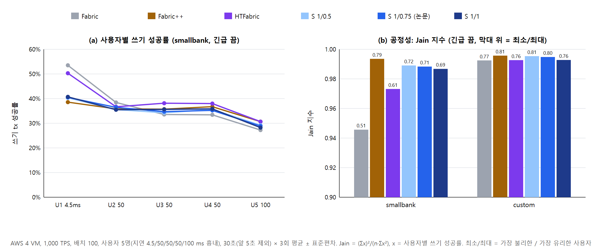
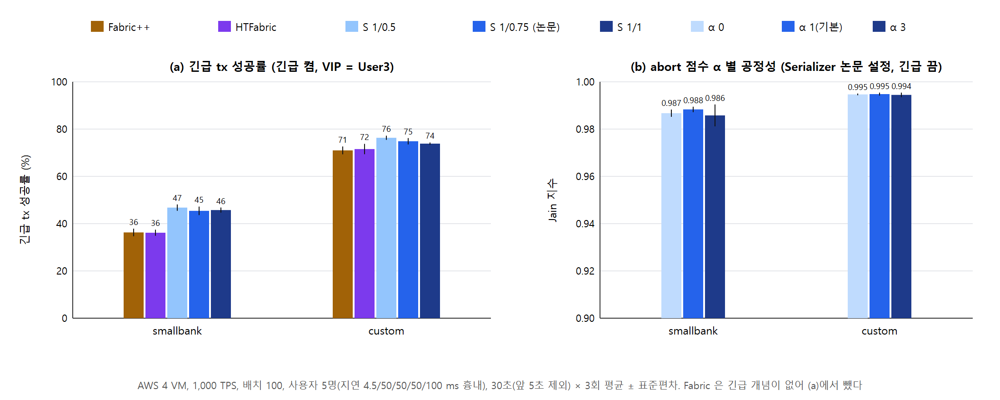

# 04. 사용자 공정성과 다른 재정렬 알고리즘 비교

**상태:** 완료. 2026-10-18 20:38~22:34 KST, 78회 모두 정상이었다. 처음 세운 계획과 확정 과정은 [`PLAN.md`](PLAN.md)에 있다(NOTES §79, §83, §84).

## 결과

전체 표(3회 평균 ± 표준편차)는 [`data/fair-summary.md`](data/fair-summary.md)에, 실행별 값은 `data/fair-data.json`에 있다.

### 그림 1. 성능 — `figures/fig1-performance`

| 긴급 끔 | Fabric | Fabric++ | HTFabric | S 1/0.5 | **S 1/0.75 (논문)** | S 1/1 |
|---|---|---|---|---|---|---|
| smallbank 성공/s | 382 | 452 | 474 | 502 | **503** | 501 |
| smallbank Query 성공률 | 39% | 55% | 56% | 65% | **65%** | 65% |
| smallbank 커밋 지연 | 192 ms | 183 | 180 | 178 | 180 | 179 |
| custom 성공/s | 674 | 726 | 736 | 673 | 702 | **740** |

- **smallbank:** Serializer가 가장 높다. Fabric 대비 +32%, Fabric++ 대비 +11%, HTFabric 대비 +6%다. Query 성공률은 65%로 Fabric++·HTFabric(55~56%)보다 높다. 일반 ε에 따른 차이는 없다(계좌 100에서는 재정렬로 더 살릴 여지가 없다, 02 참고).
- **custom:** 일반 ε가 결과를 가른다. ε 1이면 HTFabric과 같은 수준으로 가장 높다(740 대 736). 논문 설정(0.75)은 702로 Fabric++·HTFabric보다 낮다. ε 0.5는 Fabric과 같다.
- **지연:** 모든 재정렬 시스템이 Fabric보다 짧다(Fabric 192/216 ms, 나머지 178~203 ms).

### 그림 2. 사용자 공정성 — `figures/fig2-fairness`

| 긴급 끔 | Fabric | Fabric++ | HTFabric | S 1/0.5 | S 1/0.75 | S 1/1 |
|---|---|---|---|---|---|---|
| smallbank Jain | 0.946 | **0.994** | 0.973 | 0.989 | 0.988 | 0.987 |
| smallbank 최소/최대 | 0.51 | **0.79** | 0.61 | 0.72 | 0.71 | 0.69 |
| custom Jain | 0.992 | **0.996** | 0.993 | 0.995 | 0.995 | 0.993 |

- **Fabric:** 가장 가까운 사용자(U1, 4.5 ms)에게 크게 유리하다. smallbank에서 U1의 쓰기 성공률은 54%, U5는 27%다. 도착 순서대로 블록에 넣으므로 일찍 도착한 tx가 먼저 쓰고, 늦은 tx가 낡은 읽기로 무효가 된다.
- **Serializer:** 이 격차를 크게 줄인다(Jain 0.946 → 0.988, 최소/최대 0.51 → 0.71). 주로 U1의 유리함이 사라지는 모양이다(54% → 41%).
- **공정성은 Fabric++가 가장 좋다**(0.994). Serializer가 그다음이고, HTFabric(0.973)보다 높다.
- **custom:** 모든 시스템이 0.99 이상이라 차이가 작다.
- **abort 쏠림:** 모든 시스템이 0.21~0.28로 고르다(고르면 0.2).
- **최대 연속 실패:** 재정렬 시스템은 smallbank에서 20~29, custom에서 9~11이다. 시스템 사이에 뚜렷한 차이가 없다(Fabric은 25 / 11).

### 그림 3. 긴급 tx와 α — `figures/fig3-urgent-alpha`

| 긴급 켬 | Fabric++ | HTFabric | S 1/0.5 | S 1/0.75 (논문) | S 1/1 |
|---|---|---|---|---|---|
| smallbank 긴급 tx 성공률 | 36% | 36% | **47%** | 45% | 46% |
| custom 긴급 tx 성공률 | 71% | 72% | **76%** | 75% | 74% |
| smallbank Jain (VIP 제외 4명) | **0.991** | 0.965 | 0.987 | 0.986 | 0.988 |

- **긴급 tx:** Serializer가 긴급 tx를 우선한다. smallbank에서 +10%p, custom에서 +3~5%p다. Fabric++·HTFabric은 긴급 개념이 없다.
- **VIP를 뺀 4명끼리는 고르게 유지된다**(0.986~0.988). 전체 Jain(0.965~0.971)이 낮아지는 것은 VIP를 우선한 의도된 결과다.
- **긴급을 켜도 전체 처리량은 거의 같다**(smallbank 498~499/s). custom에서는 긴급 그룹이 먼저 쓴 키 때문에 일반 tx가 더 버려져 조금 줄었다(702 → 689/s, 논문 설정).
- **α는 공정성에 효과가 없었다.** Jain이 α 0 / 1 / 3에서 smallbank 0.987 / 0.988 / 0.986, custom 0.995 / 0.995 / 0.994로 같다.
  - 이 부하에서는 사용자와 계좌가 무관하다. 사용자 간 차이가 도착 지연에서만 생기므로, 희생자 선택 점수로 조정할 여지가 작다(계획의 4번 점검 사항).
  - α의 효과를 보려면 특정 사용자가 인기 계좌를 많이 쓰는 부하가 필요하다.

### 추가 분석: tx별 블록 안 위치 (NOTES §85)

공정성 차이가 어디서 생기는지 보려고 smallbank s 1.0, 1,000 TPS, 배치 100, 긴급 끔으로 Fabric·Fabric++·Serializer(1/0.75)를 1회씩 다시 돌렸다. 실행 직후 **피어**에서 블록을 모두 꺼내 tx마다 블록 안 위치·사용자·유효 여부를 읽었다. 요약은 [`data/blockpos-summary.md`](data/blockpos-summary.md)에 있다.
- 오더러 블록에는 유효 표시가 없어서 피어에서 꺼냈다.
- 수정한 Fabric은 `configtxlator`로 풀 수 없어서 필요한 필드만 protobuf wire format으로 직접 읽는다(`scripts/blockpos-extract.py`).

| 정상 구간 블록 | 블록에 든 tx U1 / U2~U5 | 쓰기 유효율 U1 / U5 | 위치 구간별 쓰기 유효율(앞 → 뒤) |
|---|---|---|---|
| Fabric | 4,223 / 4,195~4,256 | 54.6% / 26.8% | 38 / 36 / 37 / 37 / 39% |
| Fabric++ | **2,540** / 2,841~3,012 | 85.1% / 62.2% | 89 / 82 / 74 / 66 / 62% |
| Serializer | 3,185 / 3,151~3,175 | 84.4% / 58.1% | (앞쪽은 읽기 전용) / 78 / 74 / 70% |

- **Fabric:** 블록 안 위치와 유효율은 무관하다. 같은 위치 구간에서도 U1이 유리하다(앞 1/5에서 U1 54.5%, U5 26.8%). 같은 블록 안에서 U1의 tx가 가장 늦게 만들어졌다(블록 최솟값 대비 U1 +189 ms, U5 +62 ms). 순서가 정해지기까지의 시간이 짧아 이전 블록에 의해 낡을 확률이 낮다. **U1의 이점은 위치가 아니라 tx 나이에서 온다.**
- **Fabric++:** U1의 tx를 정렬 단계에서 더 많이 버린다(블록에 든 수 2,540 대 2,841~3,012). 이렇게 결과가 평평해져 공정성 지표가 가장 좋게 나온다.
- **Serializer:** 사용자마다 블록에 넣는 수가 같다(3,151~3,185). 그래서 나이에서 오는 차이는 남지만 버리는 tx가 적어 처리량이 더 높다.

### 요약

- **처리량과 Query:** smallbank에서는 Serializer가 가장 높다(+6~11% 대 재정렬 비교 대상). custom에서는 일반 ε 1일 때 HTFabric과 같은 수준이다.
- **공정성:** Fabric++ > Serializer > HTFabric > Fabric 순서다. Serializer는 Fabric의 "가까운 사용자 편중"을 크게 줄인다.
- **긴급 tx:** Serializer만 우선하며, 일반 사용자끼리의 공정성은 유지된다.
- **α:** 이 부하에서는 효과가 없다.

## 보이려는 것

1. 같은 부하에서 Serializer, Fabric++, HTFabric(WARD), Fabric의 **성능과 사용자 공정성**
2. 늦게 도착하는 사용자(지연 100 ms)가 알고리즘별로 얼마나 불리해지는지
3. Serializer의 abort 점수 e^{α·n}(사용자별 누적 abort가 적은 쪽을 버림)의 α가 공정성을 높이는지
4. 긴급 tx(VIP)를 켰을 때 VIP를 뺀 일반 사용자끼리 공정한지

## 세팅 (확정)

| 항목 | 값 |
|---|---|
| 환경 | AWS 4 VM(`../01-contention-batch/SETUP.md`와 같다). 오더러 계측 이미지, Caliper SDK 우회 |
| 부하 | **smallbank**(계좌 100, Zipf s 1.0, Query 50%) / **custom**(키 10,000, 인기 키 1%, 읽기 4·쓰기 4, 인기 키 확률 0.2/0.1) |
| 전송 | 1,000 TPS, 사용자 5명(워커 5), 지연 4.5 / 50 / 50 / 50 / 100 ms(보내기 전에 기다리는 흉내) |
| 배치 | 100 (BatchTimeout 2 s) |
| 긴급 | 끔 / 켬(User3의 쓰기 전부 = 전체의 약 10%). Fabric은 끔만 돈다 |
| 시스템 | Fabric(A1) · Fabric++(FPP) · HTFabric(HTF, 재실행 없이 정렬만) · Serializer 긴급 ε 1 × 일반 ε 0.5 / **0.75(논문 설정)** / 1 |
| α 묶음 | Serializer 논문 설정에서 α 0 / 1 / 3(α 1은 본 묶음) × 부하 2 × 긴급 끔 |
| 반복 | 30초(앞 5초 제외) × 3바퀴, 바퀴마다 시스템 순서를 바꾼다 |
| 계좌 분포 | 모든 사용자가 같다. 그래서 사용자 간 차이는 도착 지연과 알고리즘의 희생자 선택에서만 생긴다 |

## 지표 (`scripts/fair.js`)

| 구분 | 지표 |
|---|---|
| 성능 | 초당 성공, 성공률, Query 성공률, 커밋 지연 |
| 공정성 | 사용자별 쓰기 성공률의 **Jain 지수**, **최소/최대**(가장 불리한 사용자 / 가장 유리한 사용자), U5/U1(가장 먼 사용자 / 가장 가까운 사용자) |
| 쏠림 | **abort 쏠림**: 실패가 가장 많은 사용자의 몫. 고르면 0.2다 |
| 굶주림 | **최대 연속 실패**: 한 사용자의 쓰기 tx가 보낸 순서대로 연속 실패한 최대 횟수. tx별 기록에서 센다 |
| 긴급 | 긴급 tx 성공률, VIP를 뺀 4명의 Jain |

## 실험을 위해 바꾼 것

- **α 설정:** `kafka/docker-compose.processor.yml`에 `-alpha ${PROCESSOR_ALPHA:-1}`을 넣었다. 이 파일은 저장소의 다른 변경과 함께 아직 커밋하지 않았다.
- **tx별 기록:** 워크로드 [`bench/zipfbench/caliper/workload/users.js`](../../bench/zipfbench/caliper/workload/users.js)가 실행마다 `tx-<사용자>-w<워커>.json`을 남긴다(`bench/zipfbench/results/` 아래, 저장소에 넣지 않음).
  - 형식: `[보낸 시각 ms, 종류 q/n/u, 결과 s/a/f/t, 지연 ms]`
  - 결과 코드: s = 성공, a = abort 통보, f = 피어 무효, t = 시간 초과
- **사전 점검**(`scripts/cloud-fairsmoke.sh`): Fabric++(배치당 약 13개 abort)와 HTFabric(abort 없이 재정렬만)이 지금 경로에서 정상으로 돈다. α 0이 프로세서 인자로 들어가는 것을 확인했다.

## scripts/

| 파일 | 하는 일 |
|---|---|
| `cloud-fairsmoke.sh` | 사전 점검(FPP·HTF·α) |
| `cloud-fair.sh` | 본 실험(Fabric VM에서). 시스템이 바뀔 때만 네트워크를 새로 띄운다 |
| `fair.js` | 요약: 부하·긴급별 시스템 비교표. `node fair.js <results> [json]` |
| `fair-figs.js` | 그림 1~3. `node fair-figs.js data/fair-data.json figures` |
| `cloud-blockpos.sh` | 블록 위치 실행: 시스템마다 1회 돌리고 피어에서 블록을 꺼낸다 |
| `blockpos-extract.py` | 블록 파일 → tx별 CSV(block, pos, 함수, 사용자, 긴급, 유효, 생성 시각) |
| `blockpos.js` | 위치 분석. `node blockpos.js <csv 폴더>` |

- **원자료:** `bench/zipfbench/results/fair-<부하>-<라벨>/`(저장소에 넣지 않음)
- **스크립트 원본:** `bench/scripts/`
