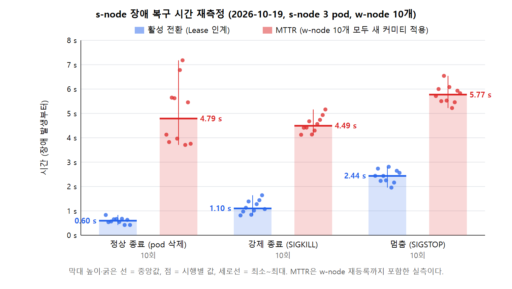

# 06. 합의 성공률 (원 논문 그림 15): s-node pod 수 × pod 장애 확률

**목적:** s-node를 몇 개의 pod로 두면(replica 1~5) pod 장애와 비잔틴 w-node가 있어도 합의 라운드가 마감(10 s) 안에 끝나는지 보인다.

**방법: 실측으로 보정한 시뮬레이션** (NOTES §87)
- 전체를 실측하면 20개 설정 × 500라운드로 약 28시간이 걸린다. 그래서 실측값으로 보정한 사건 시뮬레이션(`scripts/simulate.js`)을 쓴다.
- 보정에 쓴 실측값
  - **장애 복구(이번 재측정, 2026-10-19):** 로컬 Kubernetes, s-node 3 pod, w-node 10개, 장애 유형마다 10회. 원자료는 `data/mttr-1019-run.log`(`../03-snode-mttr/data/mttr-1019/`과 같다).

    | 장애 | 인계(활성 전환) 중앙 (범위) | MTTR(w-node 10개가 새 커미티 적용까지) 중앙 (범위) |
    |---|---|---|
    | 정상 종료(pod 삭제) | 0.60 s (0.42~0.83) | 4.79 s (3.71~7.18) |
    | 강제 종료(SIGKILL) | 1.10 s (0.82~1.64) | 4.49 s (4.13~5.16) |
    | **멈춤(SIGSTOP)** | **2.44 s (1.96~2.81)** | **5.77 s (5.22~6.54)** |

    §49 측정(중앙 5.4~5.6 s)과 같은 수준이다. 중앙값은 10회의 가운데 두 값 평균이다.
  - **라운드 시간(2026-10-13 파일럿 120라운드):** 정상 합의 0.4 s. 비잔틴 리더가 서명을 위조하면 5 s 뒤 실패 통보, 30 s 지연시키면 정체 확인(10 s × 2) 뒤 재등록이다.
- **시뮬레이션 조건**
  - w-node 10개 중 비잔틴 3개, 라운드 10 s 간격, 500라운드, 마감 10 s.
  - pod 장애는 그 라운드에 확률 p로 pod를 30 s 멈춘다(SIGSTOP, 활성 pod면 인계가 일어난다).
  - 설정마다 200회 반복했다.
- **지금 설계(§48)의 값**
  - 인계: SIGSTOP 실측 범위
  - 인계 직후 커미티: 유예 3 s 뒤 0.35 s
  - 정상 커미티: 0.35 s. 모두 등록하면 0.3 s 조용한 뒤 바로 만든다. 설계값이라 1.0 s로도 계산했고 차이는 1%p 안이다.
  - w-node 재접속: 1~2 s
- **보정 확인:** 시뮬레이션에서 멈춤 → 새 커미티는 인계 1.7~2.5 + 0.3 + 3 + 0.35 ≈ 5.3~6.2 s다. 실측 MTTR(5.2~6.5 s)과 맞는다.

## 결과

| 평균 성공률 % | pod 1 | 2 | 3 | 4 | 5 |
|---|---|---|---|---|---|
| **비잔틴 포함, pod 장애 15%** | 57.3 | 70.9 | 75.4 | 76.2 | 76.4 |
| 비잔틴 포함, pod 장애 1% | 72.3 | 73.8 | 74.1 | 73.6 | 74.0 |
| **pod 장애만 15%** | 79.5 | 95.7 | **99.1** | 99.8 | 100.0 |
| pod 장애만 5% | 91.4 | 99.3 | 99.9 | 100.0 | 100.0 |
| (예전 설계) 비잔틴 포함 15% | 51.9 | 62.1 | 64.5 | 65.0 | 65.2 |
| (예전 설계) pod 장애만 15% | 79.5 | 94.3 | 97.3 | 97.8 | 97.8 |

전체 표는 `data/simulation-1019.json`(설정마다 평균과 5~95%)과 `scripts/sim87.js`의 출력에 있다.

- **pod를 늘리면 성공률이 오르고, pod 3개면 거의 포화한다.** pod 장애만 15%일 때 pod 1개는 79.5%, 3개는 99.1%, 5개는 100%다.
- **비잔틴 w-node가 있으면 약 75%에서 포화한다.** 리더의 30%가 비잔틴이다. 그중 30 s를 지연시키는 리더는 그동안 들어온 라운드를 마감 밖으로 밀어낸다. 원 논문의 "75%를 넘지 못한다"와 같은 결론이다.
- **지금 설계(§48)가 예전 설계보다 높다.**
  - 비잔틴 포함 15%에서 pod 3~5개 기준 +10~11%p다. 정상 커미티가 3.2 s에서 0.35 s로 줄어, 서명 위조 리더 뒤에도 마감 안에 다음 리더가 합의할 수 있다.
  - pod 장애만일 때는 +1.4~2.2%p다(인계 6 s → 2 s, 재접속 8~15 s → 1~2 s).

## 한계와 원 논문과의 관계

- **시뮬레이션이다.** 인계와 MTTR은 이번 실측이다. 비잔틴 리더의 시간과 정상 합의 시간은 10-13 파일럿(이전 w-node 코드)에서 쟀다.
  - 비잔틴 w-node 기능은 브랜치 `worktree-wnode-byzantine`에만 있다.
  - 실제 스택으로 한 점을 검증하려면(예: pod 3개, 장애 15%, 100라운드) 그 기능을 지금 w-node에 합쳐야 한다.
- **MTTR 값:** 원 논문 그림 15는 MTTR을 350 ms로 두고 시뮬레이션했다. 이 확장 구현에서 w-node 재등록까지 포함해 실측하면 약 4.5~5.8 s다(§48, §87). 이 시뮬레이션은 실측값을 쓴다.
- **원 논문의 "pod 4개 이상이면 항상 쓸 수 있는 coordinator가 있다"** 는 이 시뮬레이션에서 pod 장애만 15%일 때 pod 4개 99.8%, 5개 100%와 맞는다.

## scripts/

| 파일 | 하는 일 |
|---|---|
| `simulate.js` | 사건 시뮬레이터(10-13 원본 + §87의 유예 반영). `LEGACY_MAIN=1`이면 10-13 출력 |
| `sim87.js` | 예전 설계 / 지금 설계 / 민감도를 같은 격자로 계산. `RUNS=200 node sim87.js data/mttr-1019-run.log data/simulation-1019.json` |
| `sim87-fig.js` | 그림 |
| `run.sh`, `produce.sh`, `analyze.js`, `failover*.{js,sh}` | 10-13 실제 스택 파일럿 실행 도구(비잔틴 w-node 브랜치용) |
| `figure.template.html` | 10-13 그림 틀 |

- `data/simulation-1013.json`은 10-13 시뮬레이션 결과(예전 설계)다.
