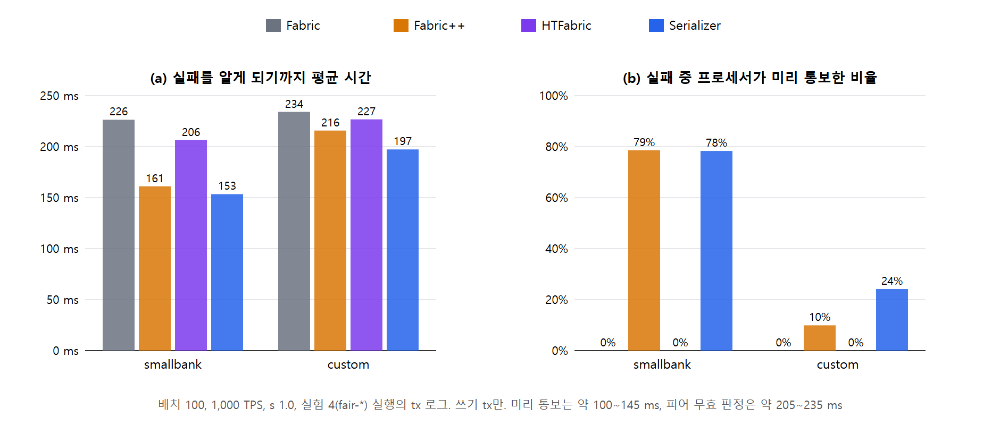
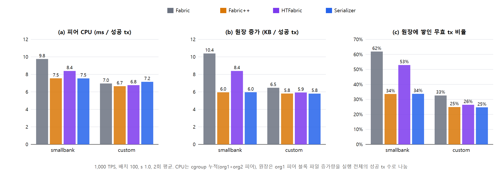
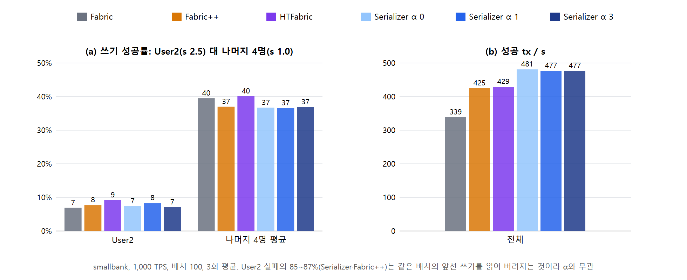

# 07. 추가 이점: 실패 통보 시간, 성공 tx당 자원, 쏠린 사용자

**목적:** 처리량과 공정성(04) 말고, Serializer의 이점이 드러날 만한 세 가지를 확인한다(NOTES §86).

**공통 조건:** AWS 클라우드(01과 같은 VM 4대), 1,000 TPS, 배치 100, 사용자 5명(흉내 지연 4.5 / 50 / 50 / 50 / 100 ms), 긴급 끔.
- 비교 시스템: Fabric, Fabric++, HTFabric, Serializer(ε 1 / 0.75)
- 그림 속 값은 아래 표와 같다. 원본 표는 `data/`에 있다.

## 실험 3. 실패를 알게 되기까지 걸리는 시간

04 실행(Zipf s 1.0, 3회)의 tx 로그를 다시 읽었다. 대상은 쓰기 tx다(`scripts/exp3.js`, 결과 `data/exp3.md`).

| 평균 ms (미리 통보 비율) | Fabric | Fabric++ | HTFabric | Serializer |
|---|---|---|---|---|
| smallbank | 226 | 161 (79%) | 206 | **153 (78%)** |
| custom | 234 | 216 (10%) | 227 | **197 (24%)** |

- Serializer와 Fabric++는 블록에 넣지 않을 tx를 프로세서가 미리 알려 준다. 미리 통보는 약 100~145 ms, 피어의 무효 판정은 약 205~235 ms에 온다.
- 실패한 클라이언트가 더 빨리 다시 보낼 수 있다는 뜻이다.
- 배치 1000(01 재측정 실행)에서는 Fabric 941 ms, Serializer 728 ms였다(미리 통보 589 ms, 피어 무효 1,336 ms. NOTES §86).
- NOTES §86에는 처음 손으로 계산한 값(Fabric 215, Serializer 172 ms)이 적혀 있다. 이 표는 `exp3.js`로 다시 계산한 값이며 비교 결론은 같다.

## 실험 2. 성공 tx 하나에 드는 자원

실행 동안 컨테이너 cgroup CPU 누적과 org1 피어 블록 파일 크기를 2초마다 기록했다. 이를 성공 tx 수로 나눴다(s 1.0, 2회, `scripts/cloud-exp21.sh` 앞부분, `scripts/exp21.js`, 결과 `data/exp21.md`).

| smallbank | Fabric | Fabric++ | HTFabric | Serializer |
|---|---|---|---|---|
| 성공/s | 384 | 454 | 474 | **500** |
| 피어 CPU ms / 성공 | 9.76 | 7.55 | 8.39 | **7.54** |
| 원장 KB / 성공 | 10.39 | 5.95 | 8.39 | **5.96** |
| 원장에 쌓인 무효 tx | 61.9% | 33.6% | 52.9% | **33.7%** |
| 오더러 CPU ms / 성공 | 1.41 | 1.31 | 1.54 | 1.58 |

- smallbank에서 Serializer는 Fabric보다 성공 tx당 **피어 CPU가 23%, 원장이 43% 적다.** 버릴 tx를 블록에 넣지 않기 때문이다. Fabric++와 비슷하고, 재정렬만 하는 HTFabric보다 적다.
- 오더러 쪽 CPU는 조금 더 든다(정렬 비용).
- custom에서는 차이가 작다. 무효 비율이 Fabric 33%, 나머지 25~26%이고, 원장은 Serializer 5.80 KB, Fabric 6.47 KB다.

## 실험 1. 한 사용자만 인기 계좌에 몰릴 때

User2만 Zipf s 2.5, 나머지 4명은 s 1.0으로 두었다(smallbank, 3회, 같은 스크립트 뒷부분, `USER_ZIPF='{"User2": 2.5}'`). Serializer는 α 0 / 1 / 3을 비교했다.

| | Fabric | Fabric++ | HTFabric | S α 0 | S α 1 | S α 3 |
|---|---|---|---|---|---|---|
| 성공/s | 339 | 425 | 429 | **481** | 477 | 477 |
| User2 쓰기 성공률 | 6.9% | 7.7% | 9.2% | 7.4% | 8.3% | 7.1% |
| 나머지 4명 평균 | 39.5% | 37.0% | 40.1% | 36.7% | 36.6% | 36.9% |

- **처리량은 Serializer가 가장 높다**(Fabric 대비 +41%).
- **쏠린 사용자(User2)는 어느 시스템에서도 보호되지 않는다**(7~9%). α를 바꿔도 같다.
  - Serializer와 Fabric++에서 User2 실패의 85~87%는 프로세서가 미리 버린 것이다.
  - 대부분은 같은 배치에서 앞에 놓인 tx가 쓴 키를 읽어서 버려진다(상태 S 검사). 이 검사에는 α가 쓰이지 않는다. α는 고리를 끊을 때 희생자를 고르는 데에만 쓰인다.
  - 인기 키 하나에는 배치당 사실상 한 명만 쓸 수 있으므로 그 키에 몰리는 사용자가 구조적으로 불리하다.
- 이런 사용자를 보호하려면 상태 S 검사에도 사용자 점수를 반영하거나 인기 키의 승자를 돌아가며 정해야 한다. 설계 변경이라 이번에는 하지 않았다.

## scripts/

| 파일 | 하는 일 |
|---|---|
| `cloud-exp21.sh` | 실험 2·1 실행(Fabric VM에서). 앞부분 = 실험 2(자원 기록), 뒷부분 = 실험 1(`USER_ZIPF`) |
| `exp21.js` | 실험 2·1 요약. `node exp21.js <results> <res-*.txt 폴더>` |
| `exp3.js` | 실험 3 요약. `node exp3.js <results> [json]` |
| `exp-figs.js` | 그림 3장. `node exp-figs.js data figures` |

- 원자료(`fair-*`, `res-*`, `skew-*`, `res-samples/`)는 `bench/zipfbench/results/`(저장소에 넣지 않음)에 있다.
