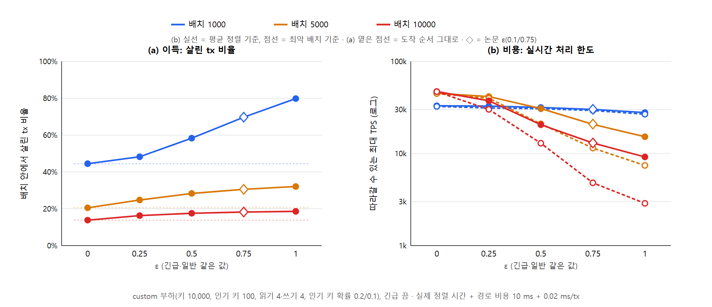
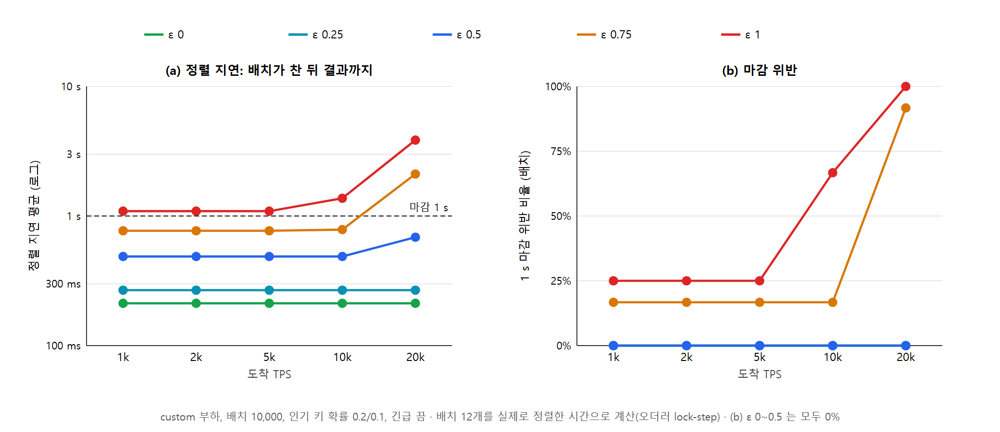
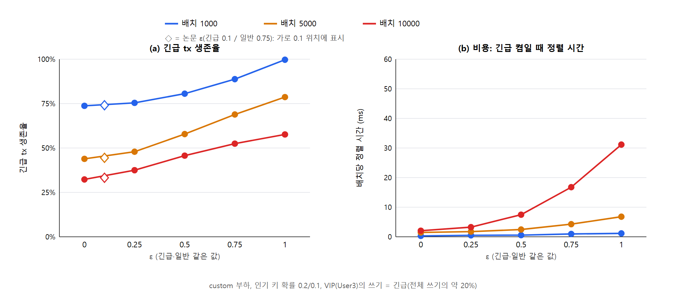
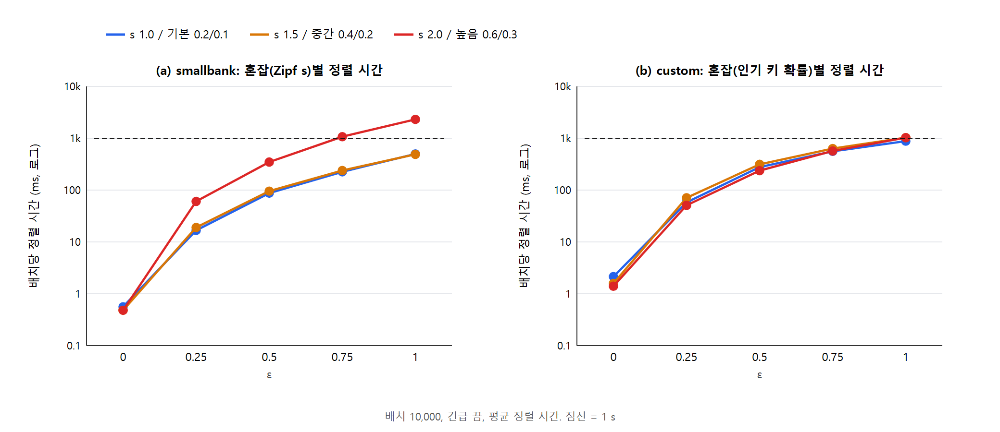
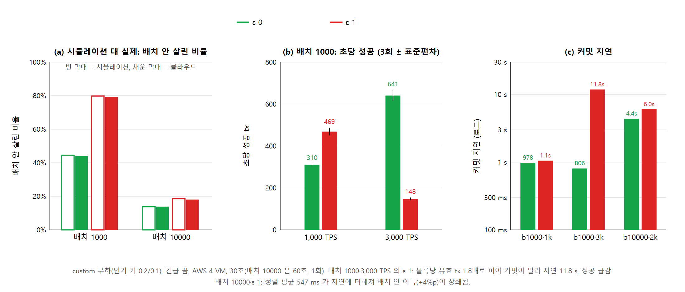

# ε 실험: 성능 지표와 그림 (NOTES §76)

**주장:** ε는 정렬 시스템의 "이득과 비용을 맞바꾸는 손잡이"다.
- ε를 키우면 충돌 그래프로 정렬하는 tx가 늘어 더 많이 살린다(이득).
- 대신 정렬 시간이 초선형으로 늘어 따라갈 수 있는 TPS가 줄고, 마감 시간을 어기게 된다(비용).
- 그래서 TPS와 배치, 혼잡에 맞춰 ε를 고르면 작은 배치에서는 최대한 살리고, 큰 배치와 높은 TPS에서는 실시간성을 지킬 수 있다.
- 기존 Fabric과 비교하는 실험이 아니다. 정렬 시스템 자체의 동작을 보인다.

## 성능 지표

| 구분 | 지표 | 정의 | 그림 |
|---|---|---|---|
| 이득 | **살린 tx 비율** | 배치 안에서 블록에 들어가 유효한 tx 수 / 배치 크기. 기준선은 "도착 순서 그대로"(= ε 0과 같은 값) | P1(a) |
| 이득 | **긴급 tx 생존율** | 살린 긴급 tx / 긴급 tx | P3(a) |
| 이득 | 공정성 (Jain 지수) | 사용자별 쓰기 성공률의 (Σx)² / (n·Σx²). 1이면 고르다 | 표 |
| 비용 | **배치당 정렬 시간** | `scheduleEpsilon` 실행 시간. 평균과 최대 | P3(b), P4 |
| 비용·실시간 | **따라갈 수 있는 최대 TPS** | 배치 / (경로 비용 + 정렬 시간). 평균 정렬 기준과 최악 배치 기준. 이 TPS를 넘으면 정렬이 배치 도착을 못 따라가 지연이 쌓인다 | P1(b) |
| 실시간 | **정렬 지연** | 배치가 다 찬 뒤 정렬 결과가 나오기까지. 앞 배치를 기다린 시간 + 경로 비용 + 정렬 | P2(a) |
| 실시간 | **마감 위반 비율** | 정렬 지연이 마감(1 s)을 넘은 배치의 비율 | P2(b) |

- **경로 비용:** 10 ms + 0.02 ms × 배치. 클라우드 실측(Kafka 왕복 7~17 ms, 오더러 메타데이터 추출 0.013~0.027 ms/tx)으로 정했다.
- **방법:** 실험 부하와 같은 모양의 합성 배치를 실제 정렬 코드로 정렬해 시간을 잰다. 그 시간으로 도착 → 배치 → 정렬의 흐름을 계산한다(오더러 lock-step). 방법의 자세한 내용은 `SIM.md`에 있다.

## 그림과 읽는 법

### P1. 맞교환 — `figP1-tradeoff` (custom, 인기 키 확률 0.2/0.1, 긴급 끔)

| 배치 | 살린 비율 ε 0 → 0.5 → 논문 → 1 | 따라갈 수 있는 TPS ε 0 → 1 (최악) |
|---|---|---|
| 1,000 | 44.5% → 58.3% → 69.7% → **79.8%** | 33k → 28k (27k) |
| 5,000 | 20.5% → 28.3% → 30.6% → 32.1% | 45k → 15k (7.4k) |
| 10,000 | 13.8% → 17.5% → 18.2% → 18.6% | 47k → **9.2k (2.9k)** |

- **배치 1000:** ε를 키우면 1.8배 더 살리고 비용은 거의 없다. → ε 1이 최선이다.
- **배치 10000:** ε 0.5를 넘으면 이득은 1%p뿐인데 최대 TPS가 21k에서 9k(최악 2.9k)로 무너진다. → ε 0.5 이하가 맞다.

### P2. 실시간성 — `figP2-realtime` (custom, 배치 10,000)

- **ε 0~0.5:** 20k TPS까지 1 s 마감 위반이 0이다.
- **ε 0.75(≈ 논문):** 배치의 17%가 위반하고, 20k에서는 92%가 위반한다.
- **ε 1:** 25%가 위반하고, 10k에서 67%, 20k에서 100%가 위반한다. 지연이 3.9 s까지 쌓인다.

### P3. 긴급 tx — `figP3-urgent` (custom, 긴급 켬)

- ε를 키우면 긴급 생존율이 오른다. 배치 1000에서는 74%(ε 0)에서 99.7%(ε 1)로, 배치 10000에서는 32%에서 58%로 오른다.
- 비용은 배치 10000·ε 1에서도 31 ms다. 긴급 그룹이 먼저 쓴 키 때문에 일반 그래프가 작아진다.
- **논문 ε(긴급 0.1)은 ε 0과 같은 수준(◇)이다.** 긴급 우선을 살리려면 ε_urgent를 크게 두는 것이 낫다.

### P4. 혼잡과 비용 — `figP4-contention` (배치 10,000, 긴급 끔)

- **smallbank:** 혼잡(s)이 클수록 같은 ε의 정렬 시간이 커진다. s 2.0에서 ε 0.75 이상은 1 s를 넘는다.
- **custom:** 정렬 시간이 혼잡과 거의 상관없이 ε로 정해진다.
- smallbank는 키가 200개라 ε를 키워도 살린 비율이 늘지 않는다(§74). 그래서 smallbank에서는 비용 쪽만 보인다.

## 결론으로 쓸 문장 (예시)

- "ε는 정렬 계산 비용의 상한을 정한다. 배치가 작을 때는 ε를 크게 두어 최대한 살리고(배치 1,000에서 ε 1은 도착 순서 대비 1.8배), 부하가 커져 배치를 키울 때는 ε를 낮춰 실시간성을 지킨다(배치 10,000에서 ε ≤ 0.5는 20k TPS까지 1 s 마감 위반 0, ε 1은 10k TPS에서 67% 위반)."
- "긴급 tx용 ε_urgent는 비용이 거의 없이(≤ 31 ms) 긴급 tx 생존율을 높인다(74% → 99.7%)."

## 한계

- 배치 안 결과만 본다. 배치 사이의 낡은 읽기는 보지 않는다.
- 시간 흐름은 계산한 것이다. 정렬 시간은 실측(로컬 PC, 12코어)이고 경로 비용은 상수다.
- 시간 흐름은 배치 12~20개뿐이다.
- 클라우드 실제 경로에서 한두 점을 확인하는 것을 권한다(예: custom 배치 1000에서 ε 0 대 1).

### P5. 클라우드 실제 경로 확인 — `figP5-cloud` (§77)

- **(a)** 배치 안에서 살린 비율이 시뮬레이션과 실제에서 0.5%p 안으로 같다.
- **(b)** 배치 1000에서 1,000 TPS일 때 ε 1은 성공이 +51%다(469 대 310/s). 3,000 TPS에서는 ε 1이 무너진다(148 대 641/s).
- **(c)** 3,000 TPS의 ε 1은 블록당 유효 tx가 1.8배라 피어 커밋이 밀려 지연이 11.8 s다. 배치 10000에서는 ε 1의 정렬(평균 547 ms)이 지연에 더해진다(4.4 → 6.0 s).
- **결론 보완:** ε의 비용은 정렬 시간뿐 아니라 "더 많이 살린 tx를 피어가 커밋하는 부담"도 있다. 그래서 부하가 낮으면 큰 ε, 피어 한계에 가까우면 작은 ε를 쓴다.
