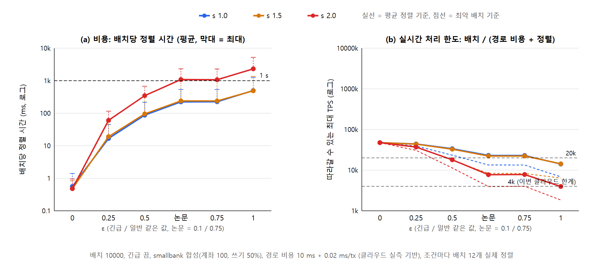
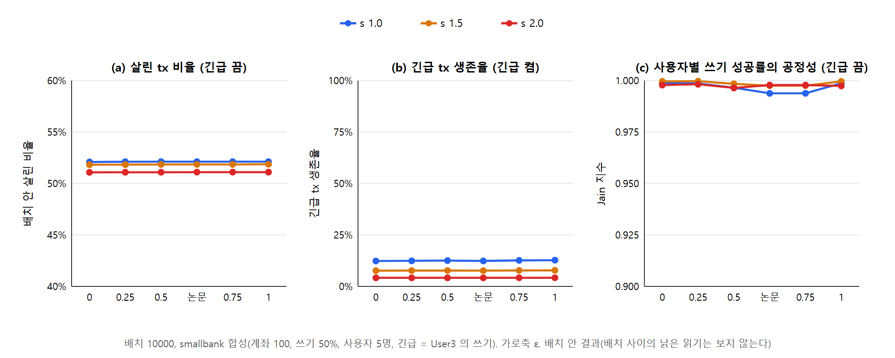
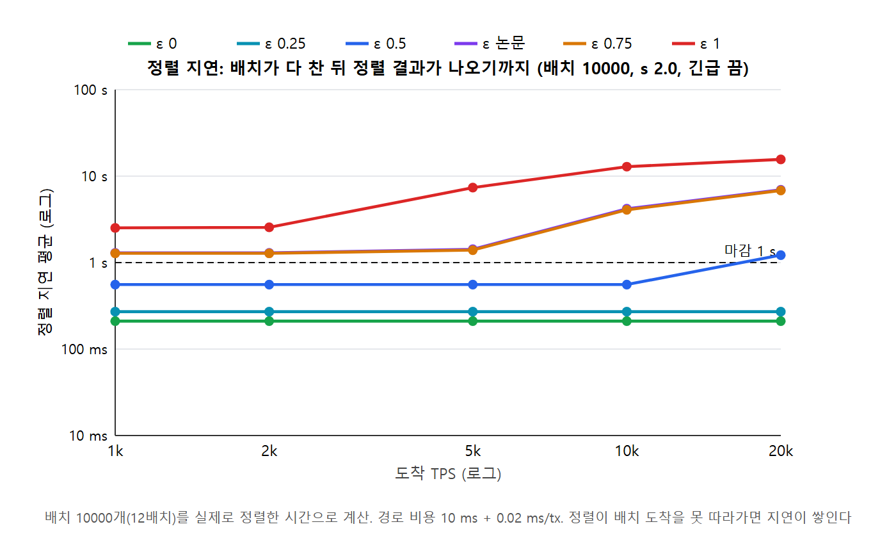
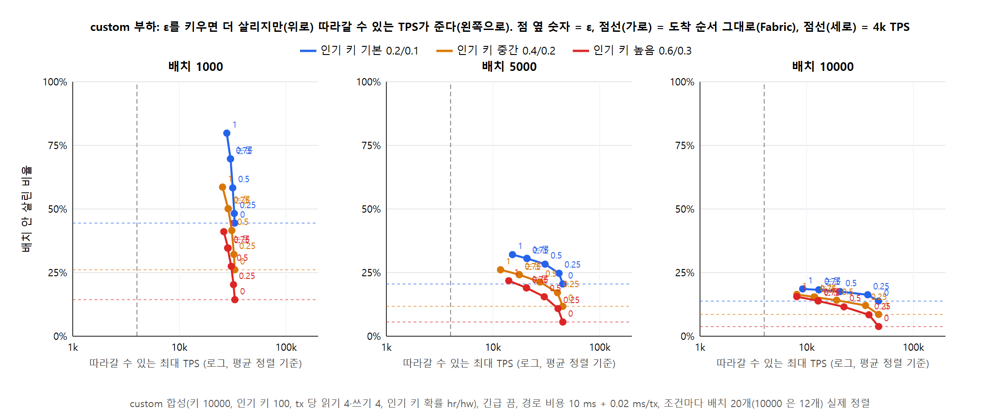

# ε 시뮬레이션: 정렬 시스템의 동작과 ε의 효과 (NOTES §74)

**목적:** 기존 Fabric과의 비교가 아니다. 정렬 시스템이 TPS와 혼잡도에 따라 어떻게 동작하는지, 그리고 그때 ε가 어떤 효과를 내는지를 보인다.

## 방법

- **코드**
  - `kafka/processor/eps_cost_test.go`의 `TestEpsSim`(`EPS_SIM=1`일 때만 돈다)
  - 격자: `kafka/processor/epssim-grid.sh`
  - 원자료: `epssim-grid.out`
  - 그림: `bench/scripts/epssim-figs.js`
- **배치:** smallbank 6종, 계좌 100, Zipf s, 쓰기 50%, 사용자 5명, 긴급 = User3의 쓰기. 실험 부하와 같은 모양의 합성 배치다.
- **정렬:** 조건마다 배치 20개(배치 10000은 12개)를 실제 `scheduleEpsilon`으로 정렬하고 배치마다 시간을 잰다. 한 조건씩 차례로 돌린다(golang 컨테이너, 이 PC).
- **시간 흐름:** 잰 정렬 시간으로 TPS마다 계산한다.
  - tx i는 i/TPS에 도착한다.
  - 배치는 마지막 tx가 도착하고 앞 배치 처리가 끝나야 잘린다(오더러 lock-step).
  - 처리 끝 = 잘린 시각 + 경로 비용 + 정렬 시간이다.
  - 경로 비용은 10 ms + 0.02 ms × 배치다. 클라우드 실측(Kafka 왕복 7~17 ms, 메타데이터 추출 0.013~0.027 ms/tx)으로 정했다.
- **지표**
  - 정렬 시간(평균, 최대)
  - 따라갈 수 있는 최대 TPS: 배치 / (경로 비용 + 정렬). 평균 기준과 최악 배치 기준 두 가지다.
  - 정렬 지연: 배치가 다 찬 뒤 결과가 나오기까지의 시간, 그리고 1 s 마감 위반 비율
  - 배치 안에서 살린 비율, 긴급 tx 생존율, 사용자별 쓰기 성공률의 Jain 지수

## 결과

**그림 E1: 비용**

**그림 E2: 이득**

**그림 E3: 시간 흐름**

**비용** (긴급 끔, 배치 10000, 정렬 ms 평균[최대] / 따라갈 수 있는 TPS 평균·최악)

| ε | s 1.0 | s 1.5 | s 2.0 |
|---|---|---|---|
| 0 | 0.6[1] / 47.5k·47.3k | 0.5[1] / 47.5k·47.4k | 0.5[1] / 47.5k·47.4k |
| 0.25 | 17[45] / 44.1k·39.2k | 19[56] / 43.7k·37.6k | 61[116] / 37.0k·30.7k |
| 0.5 | 87[218] / 33.6k·23.4k | 96[364] / 32.7k·17.4k | 347[674] / 18.0k·11.3k |
| 논문(0.1/0.75) | 223[537] / 23.1k·13.4k | 239[991] / 22.3k·8.3k | 1,086[2,322] / 7.7k·3.9k |
| 1 | 498[1,253] / 14.1k·6.8k | 490[1,356] / 14.3k·6.4k | 2,312[5,217] / 4.0k·1.8k |

배치 5000은 같은 경향에 크기가 1/3~1/7이다. 예: s 2.0, ε 1은 316[830] ms이고 따라갈 수 있는 TPS는 11.7k·5.3k다.

**마감(1 s) 위반** (긴급 끔, 배치 10000)
- s 1.0
  - ε 0.75 이하는 20k TPS까지 위반이 0이다.
  - ε 1은 낮은 TPS에서도 배치의 25%가 위반한다. 정렬 하나가 1.25 s까지 걸리기 때문이다.
  - ε 1은 20k TPS에서 모두 위반한다(지연이 쌓인다).
- s 2.0
  - ε 0.25 이하는 위반이 없다.
  - ε 0.5는 20k에서 83%가 위반한다.
  - ε 논문 값과 0.75는 1k에서도 58%가 위반하고, 10k 이상에서는 모두 위반한다.
  - ε 1은 5k 이상에서 모두 위반하고 지연이 7~16 s로 쌓인다.

**이득**
- **배치 안에서 살린 비율은 ε와 상관없다.** 차이가 0.1%p 안팎이다(s 1.0에서 52.1%, s 2.0에서 51.1%).
  - 그중 약 50%는 읽기 전용이다. 쓰기는 2~4%만 산다.
  - 계좌 100(키 200)인데 배치에 쓰기가 수천 개라, 키마다 사실상 한 개만 살 수 있다. 재정렬로 늘릴 여지가 구조적으로 없다.
- **긴급 tx 생존율은 ε와 상관없다.** 배치 10000에서 4~13%다. 일반 쓰기(2~4%)보다는 3배쯤 높다.
- **공정성(Jain)은 ε와 상관없다.** 긴급을 끄면 0.99 이상이다. 긴급을 켜면 0.37~0.71로 낮다. VIP가 우선되는 것은 의도된 결과다.
- **긴급을 켜면 정렬 비용이 거의 없다.** 모든 조건에서 21 ms 이하다. 긴급 그룹이 쓴 키 때문에 일반 tx가 그래프 전에 탈락한다.

## 해석

1. **ε는 정렬 비용의 손잡이로 확실히 작동한다.** 혼잡이 크면 큰 ε는 실시간성을 깬다(정렬이 배치 도착을 못 따라가 지연이 쌓인다). 작은 ε는 이를 막는다. "TPS·혼잡에 맞춰 ε를 낮춰 실시간성을 지킨다"는 이 결과로 보일 수 있다.
2. **이 부하에서는 ε를 키워 얻는 이득이 없다.** 살린 수, 긴급 생존, 공정성 모두 평평하다. 그래서 이 부하만으로는 "ε = 이득과 비용의 맞교환"을 보일 수 없고 "ε = 0이 최선"이 된다.
3. **맞교환을 보이려면 재정렬로 살릴 여지가 있는 부하가 필요하다.** 예: 배치에 비해 키가 많고, tx마다 읽기·쓰기 키가 여럿인 custom 부하(§32)
4. **한계**
   - 배치 안만 본다. 배치 사이의 낡은 읽기는 보지 않는다.
   - 시간 흐름은 배치 12~20개뿐이라, 지연이 쌓이는 정도를 작게 잡는다.
   - 경로 비용은 상수 모델이다.

---

# custom 부하 (NOTES §75)

**부하:** users.js custom과 같다. 키 10,000개 중 앞 100개가 인기 키다. tx마다 서로 다른 키 4개를 읽고, 따로 고른 키 4개에 쓴다. 읽기 전용은 0%다.
- 혼잡은 인기 키 확률 hr/hw로 바꾼다: 기본 0.2/0.1, 중간 0.4/0.2, 높음 0.6/0.3.
- 결과: `epssim-custom.out`, 그림 `figC1-tradeoff`, 스크립트 `bench/scripts/epssim-custom-figs.js`

**맞교환이 보인다** (긴급 끔. 살린 비율 / 정렬 ms 평균[최대] / 따라갈 수 있는 TPS)

| 배치 · 혼잡 | ε 0 (= 도착 순서) | ε 0.5 | ε 논문 | ε 1 |
|---|---|---|---|---|
| 1000 · 기본 | 44.5% / 0.3 / 33k | 58.3% / 1.6 / 32k | 69.7% / 3.1 / 30k | **79.8%** / 6.0 / 28k |
| 1000 · 높음 | 14.4% / 0.2 / 33k | 27.5% / 2.6 / 31k | 34.6% / 5.3 / 28k | **41.1%** / 8.3 / 26k |
| 5000 · 기본 | 20.5% / 1.1 / 45k | 28.3% / 53 / 31k | 30.6% / 130 / 21k | 32.1% / 219[564] / 15k |
| 10000 · 기본 | 13.8% / 2.1 / 47k | 17.5% / 277 / 21k | 18.2% / 558[1,880] / 13k | 18.6% / 880[3,268] / **9.2k (최악 2.9k)** |
| 10000 · 높음 | 3.8% / 1.4 / 47k | 11.5% / 237 / 22k | 13.9% / 572 / 13k | 15.6% / 1,028[1,710] / 8.1k |

**1 s 마감 위반** (배치 10000, 기본 혼잡)
- ε 0.5 이하는 20k TPS까지 위반이 없다.
- ε 논문 값과 0.75는 배치의 17%가 위반하고, 20k에서는 92%가 위반한다.
- ε 1은 25%가 위반하고, 10k에서 67%, 20k에서 100%가 위반한다.

**긴급 켬:** ε를 키우면 긴급 tx 생존율이 크게 오른다(배치 1000 기본: ε 0은 73.8%, ε 1은 99.7%). 비용은 작다(≤36 ms).
- 논문 ε(긴급 0.1)의 긴급 생존율은 ε 0과 같은 수준이다(74%). → ε_urgent 0.1은 긴급 우선 효과를 거의 쓰지 못한다(§32와 같은 결론).
- Jain 지수가 낮아지는 것(0.3~0.9)은 VIP를 우선한 결과다.

## 해석 (custom)

1. **ε는 이득과 비용을 맞바꾼다.** ε를 키우면 살린 비율이 오른다(배치 1000에서 1.8~2.9배). 대신 정렬 시간이 늘어 따라갈 수 있는 TPS가 준다.
2. **이득은 작은 배치에서 크고, 비용은 큰 배치에서 크다.**
   - 배치 1000에서는 ε 1이어도 6~9 ms라 공짜에 가깝다. ε 1이 최선이다.
   - 배치 10000에서는 ε 1의 이득이 ε 0.5보다 1%p 남짓 많을 뿐이다(18.6% 대 17.5%). 그런데 최대 TPS는 21k에서 9k(최악 2.9k)로 떨어지고 마감 위반이 생긴다.
   - → **TPS가 높아 배치를 키워야 하면 ε를 낮추는 것이 맞다.** 이 근거가 데이터로 보인다.
3. **배치를 키우면 배치 안에서 살릴 수 있는 비율 자체가 준다**(ε 1: 79.8% → 32.1% → 18.6%). 한 배치에 같은 인기 키를 건드리는 tx가 많아지기 때문이다. 배치 크기 선택도 이득에 영향을 준다.
4. **smallbank와 다른 이유:** custom은 키가 10,000개이고 읽는 키와 쓰는 키가 달라 재정렬로 살릴 여지가 크다. smallbank(키 200, 같은 키를 읽고 씀)는 그 여지가 없다.
